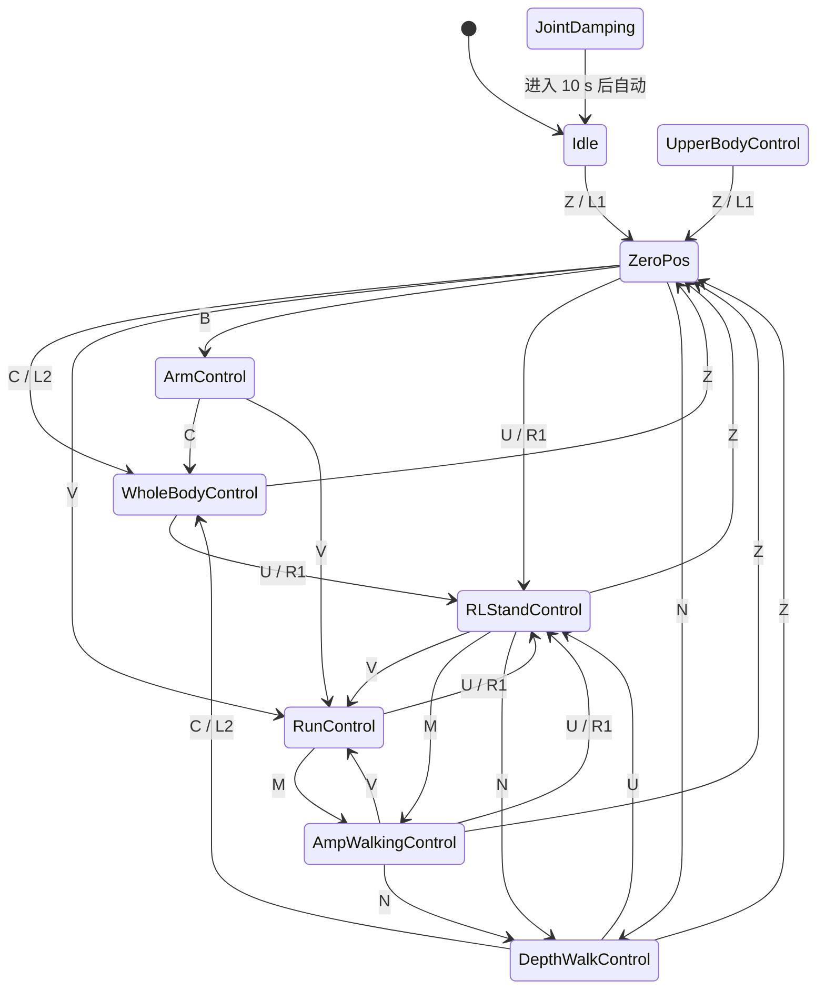

# DR2 Pro 运控状态机使用说明

> 本文档以当前 `state_machine` 源码为准，描述实际生效的状态切换、键盘/手柄操作和安全退出逻辑。

## 1. 当前运行配置

`state_machine/main.cpp` 当前固定使用：

```cpp
const ControlMode mode = ControlMode::kWholeBody;
```

因此下文以全身控制模式为主。真机启动时，程序会先提示确认机器人已进入 `Whole Body SDK` 模式；确认无误后按回车继续。

状态机启动后默认进入 `Idle`，不会直接进入任何策略控制状态。

## 2. 状态说明

| 状态 | 枚举值 | 含义 |
| --- | ---: | --- |
| `Idle` | 0 | 空闲状态，程序启动和阻尼结束后的默认状态 |
| `JointDamping` | 1 | 关节阻尼保护状态 |
| `ZeroPos` | 2 | 初始站立位姿，用 3 s 三次样条从当前关节位置过渡到目标位姿 |
| `WholeBodyControl` | 3 | 全身普通行走策略 |
| `UpperBodyControl` | 4 | 上半身控制，仅当 `main.cpp` 改为 `kUpperBody` 时使用 |
| `RunControl` | 5 | 跑步/运动策略 |
| `ArmControl` | 6 | 手臂策略控制 |
| `RLStandControl` | 8 | RL 站立控制，也是 AMP/Depth 状态的主要中转状态 |
| `AmpWalkingControl` | 9 | AMP 行走策略 |
| `DepthWalkControl` | 10 | 使用深度图的行走策略 |

`ArmLoadZeroPos` 虽然定义了枚举值 7，但当前没有对应的状态控制器，也未加入切换流程。

## 3. 实际生效的状态图



在全身模式下，按 `R` 会全局写入 `JointDamping` 请求；除 `Idle` 和已处于 `JointDamping` 外，上表其他状态都会因此转入阻尼。另外，除 `Idle`/`UpperBodyControl` 的特殊实现外，相关控制状态检测到 `safe_control_mode != 0` 时也会进入阻尼。

## 4. 键盘操作

### 4.1 模式键

| 按键 | 目标状态 | 可生效的当前状态 |
| --- | --- | --- |
| `Z` | `ZeroPos` | `Idle`、`JointDamping`、`WholeBodyControl`、`UpperBodyControl`、`RLStandControl`、`AmpWalkingControl`、`DepthWalkControl` |
| `C` | `WholeBodyControl` | `ZeroPos`、`ArmControl`、`DepthWalkControl` |
| `V` | `RunControl` | `ZeroPos`、`ArmControl`、`RLStandControl`、`AmpWalkingControl` |
| `B` | `ArmControl` | `ZeroPos` |
| `U` | `RLStandControl` | `ZeroPos`、`WholeBodyControl`、`RunControl`、`AmpWalkingControl`、`DepthWalkControl` |
| `M` | `AmpWalkingControl` | `RunControl`、`RLStandControl` |
| `N` | `DepthWalkControl` | `ZeroPos`、`RLStandControl`、`AmpWalkingControl` |
| `R` | `JointDamping` | 全身模式下，除 `Idle` 和 `JointDamping` 外的状态 |

### 4.2 速度键

以下按键仅在运动状态中生效：

| 按键 | 作用 |
| --- | --- |
| `W` / `S` | 前后速度比例 `+0.1 / -0.1` |
| `A` / `D` | 侧向速度比例 `+0.1 / -0.1` |
| `Q` / `E` | 旋转速度比例 `+0.1 / -0.1` |

键盘中的 `forward_vel_scale`/`side_vel_scale`/`turnning_vel_scale` 是归一化输入比例，输入范围为 `[-1.0, 1.0]`，不是机器人的实际速度上限。各状态的策略会再按构造时设置的 `max_cmd_vel = (vx, vy, yaw)` 进行缩放：

```text
cmd_vel = input_scale ⊙ max_cmd_vel
```

| 当前状态 | 构造时的 `max_cmd_vel` | 最终速度命令范围 `(vx, vy, yaw)` |
| --- | --- | --- |
| `WholeBodyControl` | `(1.0, 0.5, 1.57)` | `[-1.0, 1.0]`, `[-0.5, 0.5]`, `[-1.57, 1.57]` |
| `RunControl` | `(1.0, 0.5, 1.57)` | `[-0.5, 1.0]`, `[-0.5, 0.5]`, `[-1.57, 1.57]` |
| `ArmControl` | `(1.0, 0.5, 1.57)` | `[-1.0, 1.0]`, `[-0.5, 0.5]`, `[-1.57, 1.57]` |
| `RLStandControl` | `(0.8, 0.5, 0.5)` | `[-0.8, 0.8]`, `[-0.5, 0.5]`, `[-0.5, 0.5]` |
| `AmpWalkingControl` | `(1.0, 1.0, 1.0)` | `[-1.0, 1.0]`, `[-1.0, 1.0]`, `[-1.0, 1.0]` |
| `DepthWalkControl` | `(1.0, 0.5, 1.57)` | `[-1.0, 1.0]`, `[-0.5, 0.5]`, `[-1.57, 1.57]` |

其中 `vx`/`vy` 通常按 m/s 理解，`yaw` 按 rad/s 理解，但最终含义仍需与对应策略训练时的 command 定义保持一致。`RunControl` 对后退方向做了额外的非对称映射，因此尽管构造值中 `vx_max = 1.0`，实际后退上限为 `-0.5`。

键盘当前是“每按一次将输入比例增加/减少 `0.1`”的设计，所以同样的一次按键在不同状态中代表的实际速度增量不同。松键后输入比例不会自动归零；离开所有运动状态后才会清零。策略内部还会对速度输入做渐变限制，因此最终 `cmd_vel` 会逐步跟随目标值。操作时应以终端打印的 `cmd_vel` 为准，而不只看 `forward`/`side`/`turn` 比例。

运动状态包括：`WholeBodyControl`、`RunControl`、`ArmControl`、`RLStandControl`、`AmpWalkingControl` 和 `DepthWalkControl`。

### 4.3 RLStand 手臂动作

| 按键 | 作用 |
| --- | --- |
| `1` | 右臂平滑运动到挥手准备位 |
| `2` | 准备完成后开始挥手 |
| `3` | 敬礼预设 |
| `4` | 手臂回到 home 预设 |

这些按键会全局生成一个短脉冲，但当前只有 `RLStandPolicyRunner` 实际消费这些命令。`5` 和 `6` 虽然保留了数据字段，但键盘与策略逻辑均未启用。

## 5. 手柄操作

手柄按键通过 `/GAMEPAD_KEY` 话题输入，当前支持：

| 按键 | 实际切换 |
| --- | --- |
| `L1` | `Idle`/`UpperBodyControl`/`JointDamping` → `ZeroPos` |
| `L2` | `ZeroPos` → `WholeBodyControl`；`DepthWalkControl` → `WholeBodyControl`（上半身配置时为 `UpperBodyControl`） |
| `R1` | `ZeroPos`/`WholeBodyControl`/`RunControl`/`AmpWalkingControl` → `RLStandControl` |
| `R2` | `ZeroPos`/`RLStandControl`/`AmpWalkingControl` → `DepthWalkControl` |

`R1` 在 `ArmControl` 中会写入 RLStand 请求，但 `ArmControl` 本身未实现该跳转，所以实际不会切换。手柄当前没有 JointDamping 快捷键。

速度输入来源：

- `/STEER`：直接写入 `x/y/yaw`。
- `/REAL_STEER`：前后保持原值，侧向除以 `0.75`，旋转除以 `2.25`，最后限幅到 `[-1, 1]`。
- 仿真编译时额外接收 `/SIM_STEER`，对 `x/y/yaw` 直接限幅到 `[-1, 1]`。

## 6. 推荐操作流程

### 6.1 普通全身行走

```text
Idle --Z--> ZeroPos --等待约 3 s--> --C--> WholeBodyControl
```

### 6.2 RL 站立与 AMP 行走

```text
Idle --Z--> ZeroPos --等待约 3 s--> --U--> RLStandControl --M--> AmpWalkingControl
```

从 AMP 回到 RLStand 按 `U`，回到 ZeroPos 按 `Z`。

### 6.3 深度行走

```text
Idle --Z--> ZeroPos --等待约 3 s--> --N--> DepthWalkControl
```

进入前必须确保深度策略已加载，且机器人接口已收到有效深度帧。从 DepthWalk 返回 RLStand 按 `U`，返回 ZeroPos 按 `Z`。

### 6.4 Run 与 Arm

```text
Idle --Z--> ZeroPos --V--> RunControl
Idle --Z--> ZeroPos --B--> ArmControl
```

`ArmControl` 可按 `C` 进入 `WholeBodyControl`，或按 `V` 进入 `RunControl`。

## 7. 安全逻辑

### 7.1 主动阻尼

全身模式下按 `R` 后，状态机切换到 `JointDamping`。阻尼状态保持 10 s，然后自动返回 `Idle`。如需再次运动，必须从 `Z -> ZeroPos` 重新开始。

### 7.2 自动安全检查

真机环境会启动 `SafeController`，监控：

- 关节数据为 NaN、长时间不更新；
- IMU 数据为 NaN、长时间不更新；
- 电机温度高于 `110 ℃`。

检测到错误后会将 `safe_control_mode` 设为非 0，正在运行的相关控制状态会转入 `JointDamping`。当前代码没有自动清除 `safe_control_mode` 的逻辑；发生安全故障后，应先排除原因，再重启运控程序。

### 7.3 策略不可用

`RLStandControl`、`AmpWalkingControl` 在策略未加载时会转入阻尼。`DepthWalkControl` 在策略未就绪、没有深度帧或深度帧无效时也会转入阻尼。

相关策略文件：

```text
state_machine/policy/model_0610_rl_moveboxes.onnx  # RLStand
state_machine/policy/policy_0610_walking.onnx     # AMP walking
state_machine/policy/0801/0-depth_encoder.onnx    # Depth encoder
state_machine/policy/0801/actor.onnx              # Depth actor
```

## 8. 启动命令

在已完成编译的 ROS 2 工作空间中执行：

```bash
source /opt/ros/humble/setup.bash
source install/setup.bash
ros2 run dr2_pro_sdk state_machine
```

如使用 ROS 2 Jazzy，将第一行改为：

```bash
source /opt/ros/jazzy/setup.bash
```

仿真和运控程序必须使用相同的 `ROS_DOMAIN_ID`。

## 9. 当前代码中需特别注意的限制

1. `RunControl` 界面中虽然会响应 `Z`/`C`/`B` 并打印目标状态，但 `RunControlState::GetNextStateName()` 只接受 `U -> RLStand` 和 `M -> AmpWalking`；因此 `Z`/`C`/`B` 实际不会离开 RunControl。
2. `ArmControl` 中按 `Z` 会写入 ZeroPos 请求，但状态实现未接受该跳转；当前应使用 `C` 或 `V` 离开 ArmControl。
3. 终端启动菜单是概括性提示，不代表每个按键在所有状态都生效；应以本文的“可生效的当前状态”为准。
4. 状态切换时终端会打印 `old_state ------------> new_state`。只有看到这条日志，才表示状态已真正切换。
