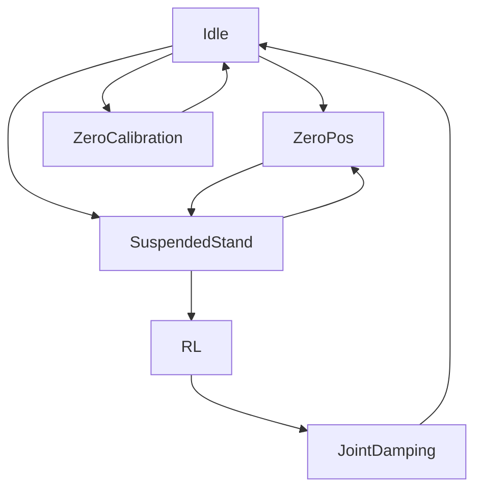

# motion_master

CR1 人形机器人运动控制主程序（CR1PRO / CR1STANDARD），基于 DRDDS 通讯中间件，通过 RL 策略推理输出关节指令，并由上位机经 DDS 指令接口（kDDS）进行控制。


## 编译选项

| 选项 | 取值 | 说明 |
|------|------|------|
| `BUILD_PLATFORM` | `arm` / `x86` | 目标平台，不指定则自动检测当前架构 |
| `BUILD_SIM` | `ON` / `OFF` | 是否编译仿真模式（Pybullet） |
| `SEND_REMOTE` | `ON` / `OFF` | 编译后自动 sftp 推送至远程主机 |
| `ROBOT` | `cr1` | 机型选择，默认 `cr1`，链接对应策略库 |

### 打包

```bash
make -j4 package              # 普通 deb 包
```

---

## 各模块介绍

### state_machine — 状态机



主要状态说明：

| 状态 | 功能 |
|------|------|
| **Idle** | 空闲，关节不发力（开机默认） |
| **ZeroPos** | 回零位 |
| **ZeroCalibration** | 打限位校准零位 |
| **SuspendedStand** | 悬架预站立 → 起立，可切入 RL |
| **RL** | RL 策略控制 |
| **JointDamping** | 软急停，关节阻尼 |

### interface — 接口层

```
Robot Interface              User Command Interface
├── hardware                 ├── DdsInterface (默认)
│   ├── CR1Std              ├── SkydroidGamepadInterface
│   ├── CR1Pro              └── RetroidGamepadInterface
│   └── ecan 基类
└── simulation
    └── PybulletInterface
```

- **Robot**：实物通过 Ecan 总线 + DRDDS 与硬件通讯；仿真通过 Pybullet
- **User Command**：支持 DDS 话题、键盘、多协议手柄，默认使用 DDS

### run_policy — 策略库

按机型拆分，各自独立维护：

```
run_policy/
└── cr1/                     # CR1 系列（include + lib + change_log）
```

通过 `-DROBOT=cr1` 选择，编译时链接对应 `libRunPolicy.a`。

### model_inference — 模型推理

模型推理封装，基于 ONNX Runtime 加载策略网络，实时输出关节 action。

### conf — 配置文件

| 文件 | 说明 |
|------|------|
| `config.toml` | 主配置（数据流/关节保护/地形策略/HeightMap/SafeController 等） |
| `log.properties` | 日志级别配置 |
| `runtime_params.toml` | 运行期参数实时快照（程序自动写入，禁止手动编辑） |

### utils — 工具集

| 模块 | 说明 |
|------|------|
| `SafeController` | 安全控制器：故障检测/分组/分级，软急停，姿态超限检测 |
| `JointProtection` | 关节指令三级保护（L1 硬限位 / L2 软限位 / L3 边界日志） |
| `RuntimeParams` | 运行期参数实时快照，1Hz 后台回写 TOML |
| `DataStreaming` | 数据流：在线监测 + 轮转 CSV 记录 |
| `NeckGamepadOverride` | 脖子关节手柄接管 |
| `MotionStateFeedback` | 运动状态反馈与遥测 |

---

## 部署

### 1. 交叉编译部署（x86 → arm）

```bash
# 安装交叉编译工具
sudo apt-get install gcc-aarch64-linux-gnu g++-aarch64-linux-gnu

# 编译
mkdir build && cd build
cmake .. -DBUILD_PLATFORM=arm -DBUILD_SIM=off -DSEND_REMOTE=ON -DROBOT=cr1
make -j4

# 推送至远程主机（需先配置 scripts/sftp_to_remote.sh 中的 IP/用户名）
make push_to_robot
```

### 2. 运动主机本地编译

```bash
mkdir build && cd build
cmake .. -DBUILD_PLATFORM=arm -DBUILD_SIM=off -DSEND_REMOTE=OFF -DROBOT=cr1
make -j4
./motion_master
```

### 3. 服务模式

```bash
sudo journalctl -u motion_master.service -f    # 查看服务日志
```