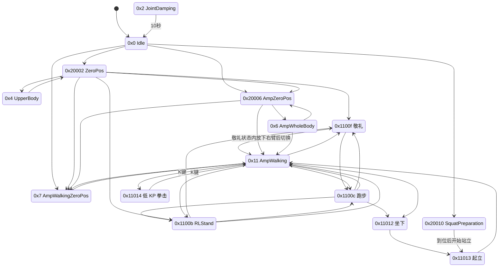

# CR1PRO 使用说明

当前项目注册 19 个可运行的 CR1PRO 状态。`motion_1` 至 `motion_10` 使用 `0x1100b` 至 `0x11014`，`motion_11` 和 `motion_12` 使用保留地址 `0x11015` 和 `0x11016`。
`main.cpp` 使用 `RobotName::CR1PRO`，默认 `RemoteCommandType::kDDS`，状态机默认 `ControlMode::kWholeBody`。
与参考项目一致，`MOTION_MASTER_CTRL_MODE=keyboard|retroid|skydroid` 可选择其他指令入口；未设置或设为`dds`时使用DDS手柄，未知值报错退出。
启动进入Idle。底层CR1STANDARD硬件及参数文件仍保留，但这套状态机只接受CR1PRO，不能通过修改入口型号直接运行STANDARD。

## 状态编号与切换

DDS 状态码使用 32 位。当前协议表见下方，手柄按钮对应关系见 [展示流程](../../展示流程.md#cr1pro-sdk)。`0x11017` 至 `0x1101b` 已退役。

下表列出实际控制器允许的后继，包含 `LoseControlJudge()` 的阻尼出口。请求未被当前状态处理时继续保持当前状态。
Idle在 `safe_control_mode != 0` 时保持Idle；所有运动状态在安全故障或显式急停时进入阻尼；策略不可用／推理失败也回退到阻尼。

| 值 | 状态 | 主要控制行为 | 合法后继（不含保持自身） |
|---:|---|---|---|
| `0x0` | `Idle` | 全身模式发送零命令，上半身模式保持入态姿态 | `0x20002`、`0x20006`、`0x7`、`0x20010` |
| `0x2` | `JointDamping` | 关节阻尼，保持约 10 秒 | `0x0` |
| `0x20002` | `ZeroPos` | 回到预设零位 | `0x2`、`0x1100b`、`0x4`、`0x7`、`0x20006`、`0x1100f`、`0x11010`、`0x11011`、`0x1100d`、`0x1100e` |
| `0x4` | `UpperBodyControlMode` | 上半身轨迹控制 | `0x2`、`0x20002` |
| `0x6` | `AmpWholeBodyControlMode` | AMP 全身控制和手臂预设 | `0x2`、`0x11`、`0x20006` |
| `0x7` | `AmpWalkingZeroPos` | AMP 行走准备姿态 | `0x2`、`0x11` |
| `0x11` | `AmpControl_Walk_Mode` | 拟人行走 | `0x2`、`0x1100b`、`0x7`、`0x1100c`、`0x1100f`、`0x11010`、`0x11011`、`0x1100d`、`0x1100e`、`0x11012`、`0x11014` |
| `0x1100b` | `RLControl_Stand_Mode` | 15 自由度 RL 站立 | `0x2`、`0x11`、`0x1100c`、`0x1100f`、`0x11010`、`0x11011`、`0x1100d`、`0x1100e` |
| `0x1100c` | `AmpControl_Walk2Run_Mode` | 跑步（motion_2） | `0x2`、`0x11012`、`0x1100b`、`0x11`、`0x1100f`、`0x11010`、`0x11011`、`0x1100d`、`0x1100e` |
| `0x1100d` | `RLControl_StandTalking_Mode` | 配合讲解的手势 | `0x2`、`0x11`、`0x1100c`、`0x1100f`、`0x11010`、`0x11011`、`0x1100e` |
| `0x1100e` | `RLControl_StandPlease2_Mode` | 欢迎手势 | `0x2`、`0x11`、`0x1100c`、`0x1100f`、`0x11010`、`0x11011`、`0x1100d` |
| `0x1100f` | `RLControl_StandSalute_Mode` | 右臂敬礼，返回行走前收臂 | `0x2`、`0x11`、`0x1100c`、`0x11010`、`0x11011`、`0x1100d`、`0x1100e` |
| `0x11010` | `RLControl_StandSaluteLeftArm_Mode` | 左手向前欢迎，返回行走前收臂 | `0x2`、`0x11`、`0x1100c`、`0x1100f`、`0x11011`、`0x1100d`、`0x1100e` |
| `0x11011` | `RLControl_StandPlease_Mode` | 双臂向左邀请，返回行走前收臂 | `0x2`、`0x11`、`0x1100c`、`0x1100f`、`0x11010`、`0x1100d`、`0x1100e` |
| `0x11012` | `MimicControl_ChairDown_Mode` | 椅子坐姿，末帧保持 | `0x2`、`0x11013` |
| `0x11013` | `MimicControl_ChairUp_Mode` | 坐姿起立，动作到位后接受行走请求 | `0x2`、`0x11` |
| `0x11014` | `MimicControl_BoxFight_Mode` | 低 KP 拳击，末帧保持 | `0x2`、`0x11` |
| `0x11015` | `MimicControl_LieDown_Mode` | SDK 保留，当前版本拒绝该命令 | — |
| `0x11016` | `MimicControl_GetUp_Mode` | SDK 保留，当前版本拒绝该命令 | — |
| `0x20006` | `AmpZeroPos` | AMP 准备姿态 | `0x2`、`0x6`、`0x7`、`0x11` |
| `0x20010` | `SquatPreparation` | 蹲姿准备，到位后可请求起立 | `0x2`、`0x11013` |

主要运动切换见下图，完整后继见上表：



源WholeBody Idle未主动发送命令；当前硬件层会持续使用上一帧，因此迁移后Idle主动发送31×5零命令，避免继续执行旧主动指令。
ZeroPos、AmpZeroPos、AmpWalkingZeroPos均先完成3秒插值，再处理普通状态切换；提前收到的合法目标会等待插值结束。安全故障和急停立即生效，不受等待限制。
WholeBody 下，AMP行走可请求 MimicControl_ChairDown_Mode（`0x11012`）完成坐下，再请求 MimicControl_ChairUp_Mode（`0x11013`）完成起立。Mimic13 不再做入口平滑，必须跑完参考步数后才接受 AMP行走（`0x11`），随后返回 AMP Walking。
AMP全身策略进入时继承上一状态的手臂目标；重新进入策略会清除瞬时推理故障，模型加载失败仍回退阻尼。

## 键盘、DDS与GUI

键盘大小写等效。表中“请求”指更新目标状态，实际切换仍以上面的状态图为准。

| 按键 | 允许发出请求的当前状态 | 目标请求 |
|---|---|---|
| R | 全部控制模式 | `0x2` JointDamping |
| Z | Idle、JointDamping、ZeroPos | `0x20006` AmpZeroPos |
| F | Idle、JointDamping、AmpWholeBody | `0x20006` AmpZeroPos |
| C | AmpZeroPos、WholeBody 模式的敬礼或左手欢迎 | `0x11` AmpWalking |
| U | WholeBody模式的RLStand、AmpWalking | `0x1100f` RLControl_StandSalute_Mode |
| M / C | WholeBody模式的RLStandSalute | 先在敬礼状态放下右臂，反馈到位后切换 `0x11` AmpWalking |
| H | AmpZeroPos | `0x6` AmpWholeBody |
| J | Idle、JointDamping、ZeroPos、AmpZeroPos、AmpWalking | `0x7` AmpWalkingZeroPos |
| L | AmpWalkingZeroPos | `0x11` AmpWalking |
| V | 跑步、普通 AMP 行走 | `0x1100b` RLStand |
| M | 跑步、RL 站立 | `0x11` AmpWalking |
| B | WholeBody模式的RLStand、AmpWalking | `0x1100c` motion_2 / 跑步 |
| N | WholeBody模式的RLControl | `0x11012` motion_8 / 坐下 |
| M | WholeBody模式的Mimic12 | `0x11013` motion_9 / 坐姿起立 |
| M | WholeBody模式的Mimic13 | `0x11` AmpWalking |
| K | WholeBody模式的AmpWalking、低 KP 拳击 | `0x11` AmpWalking／`0x11014` 低 KP 拳击（互相切换） |
| 1..6 | 指令入口均可设置，由相应runner消费 | 手臂预设1..6，并递增预设序号 |

F支持从AmpWholeBody返回AmpZeroPos，J支持从AmpWalking返回AmpWalkingZeroPos，返回后重新执行3秒准备插值。
UDP急停会丢弃同批普通按键／速度输入，键盘、手柄和DDS也不能覆盖尚未被状态机执行的急停。状态反馈进入阻尼或Idle后才允许新目标。
R在Idle保持被动Idle状态。JointDamping中的Z/F/J只更新待处理目标，仍需先保持10秒并返回Idle，再由Idle处理。

Idle 中驱动器故障位 `kSafeDriverStatus` 有效时，调用 `ResetJointError()` 清除驱动故障并重新使能；
首次尝试在进入 Idle 至少3秒后执行，持续故障每隔至少3秒重试。其他安全故障不触发驱动恢复。
故障位未清除时保持 Idle，已有目标请求继续保留，故障清除后再按状态图切换。

W/S每次将前向指令增减0.05并保持；A/D控制侧向，Q/E控制转向，侧向和转向在最后输入1秒后归零；X清零速度。
这些键盘速度命令只在跑步、RL 站立、AMP 全身和普通 AMP 行走中消费，其他状态清零。
跑步／RL 站立／AMP 全身的指令限幅为各轴±0.8；AmpWalking为前向[-0.6,1.5]、侧向±0.5、转向±1.57。
这些值是 `UserCommand` 中的指令量，runner还会按各自最大速度参数缩放。
手臂预设由 AMP 全身与 RL 站立处理，普通 AMP 行走由网络控制手臂。

默认DDS手柄模式启用以下入口（Keyboard模式保留按键、速度和脖子话题，但不订阅状态／步态话题）：

| DDS话题 | 内容 |
|---|---|
| `/MOTION_STATE` | 32位状态码，使用上面的状态表和合法切换图 |
| `/GAIT` | 仅接受HumanWALK=`0x21000`，更新步态反馈；不额外切换运动状态 |
| `/GAMEPAD_KEY` | `G20_KEY_L1/L2/R1/R2` 字符串，使用下表手柄映射 |
| `/STEER` | 前向、侧向、转向指令 |
| `/REAL_STEER` | 保留源缩放与限幅后的速度入口 |
| `/NECK_STEER` | 脖子yaw／pitch接管输入，是否生效由硬件脖子配置决定 |

全身（WholeBody）模式下，DDS与Retroid手柄共用以下映射：

| 手柄按键 | 允许发出请求的当前状态 | 目标请求 |
|---|---|---|
| L1 | Idle、JointDamping、ZeroPos | `0x20006` AmpZeroPos |
| L2 | 跑步、AMP 准备、AMP 行走准备、RL 站立、敬礼、左手欢迎 | `0x11` AmpWalking |
| R1 | 跑步、普通 AMP 行走 | `0x1100b` RLStand |

常用流程为 `L1 → L2 → R1`，依次请求 AMP 准备、普通 AMP 行走和 RL 站立。键盘 R 与安全保护仍可请求阻尼。
上半身（UpperBody）模式下，L1在Idle／UpperBody请求ZeroPos，L2在ZeroPos请求UpperBody；该模式需要在构造状态机时显式选择 `kUpperBody`。
手柄按键入口会关闭手臂预设规划，数字1..6重新启用。
DDS的`/STEER`和`/REAL_STEER`任一话题更新即可续期；超过2秒无新速度包时清零速度，退出支持速度的状态也清零。`/REAL_STEER`按前向x、侧向y/0.75、转向yaw/2.25归一化至±1，再沿用入口和runner的限幅。

默认`kDDS`接口按明确的已注册状态白名单接收`/MOTION_STATE`，不按连续数字范围放行。旧的1、3、5、8、13及未知编号被拒绝，目标保持不变；0x2始终表示阻尼。所有请求仍受当前控制器的合法出口和安全条件约束。
`/ACTION`不启用；`/GAIT`只接受HumanWALK。DDS启动时将步态设为HumanWALK，摇杆不要求先收到步态包。

GUI UDP保留源按键、速度、急停及14关节手臂目标包协议，与本地键盘共用映射。RL 站立使用共享节点，构造runner本身不会创建socket。
默认配置位于 `conf/config.toml`：

```toml
[pro_sdk]
udp_enabled = true
udp_local_ip = "10.21.33.103"
udp_local_port = 8888
udp_remote_ip = "10.21.33.7"
udp_remote_port = 9999
```

将 `udp_enabled` 改为 `false` 可关闭UDP，保留本地键盘、DDS及手臂预设。
UDP创建或绑定失败时也禁用远程节点，不会让runner反复绑定端口。
`MOTION_MASTER_CONFIG` 可指定这段配置所在文件；显式路径不存在时报错。
未指定时依次探测 `/var/opt/robot/conf/motion_master/config.toml`、仓库 `conf/config.toml`。
该覆盖项用于PRO UDP配置，不会统一覆盖所有既有硬件配置加载器的路径。

## 关节、参数与策略模型

SDK顺序为 **腰3 + 左臂7 + 右臂7 + 左腿6 + 右腿6 + 脖子2**。
策略处理前29轴，状态层将29×5输出补上2行脖子命令组成31×5。
RLStand模型输出15维：左腿6、右腿6、腰3；runner补上14个手臂预设／UDP目标后生成29轴。
AMP保留源29关节交错训练顺序及SDK排列映射，RL观测保留左腿、右腿、腰、左臂、右臂的排列。

| 状态／runner | `policy/` 下模型路径 | 单帧观测×历史 | 网络动作 | 推理周期 |
|---|---|---:|---:|---:|
| AmpControl_Walk2Run_Mode | `amp_policy/policy_1022_75k.onnx` | 102×5=510 | 29 | 20ms |
| Mimic12 | `mimic_policy/model_stand2sit_1020.onnx` | 151×1，另有time_step | 29 | 20ms |
| Mimic13 | `mimic_policy/sit2stand.onnx` | 154×1，另有time_step | 29 | 20ms |
| Tangxia | `recovery_policy/tangxia/model_11000.onnx` | 151×1，另有time_step | 29 | 20ms |
| Zhanli | `recovery_policy/zhanli/model_8000.onnx` | 151×1，另有time_step | 29 | 20ms |
| 低 KP 拳击 | `mimic_policy/box_fight.onnx` | 158×1，另有time_step | 29 | 20ms |
| AmpWalking | `amp_policy/amp_1018.onnx` | 102×(5帧历史+当前帧)=612 | 29 | 20ms |
| AmpWholeBody | `amp_policy/policy_arm.onnx` | 96×5=480 | 29 | 20ms |
| RLStand | `rl_policy/model_0610_rl_moveboxes.onnx` | 84×6=504 | 15 | 10ms |
| RLStandSalute | 同RLStand模型 | 84×6=504 | 15（双臂独立规划） | 10ms |

AmpWalking 使用5帧零初始化历史，按“最旧历史→最新历史→当前帧”输入网络。
默认姿态、PD增益及观测缩放对齐 `amp_1018` 训练配置，动作先裁剪至 ±10，再乘 0.25 加到默认姿态。
速度命令范围为前后 `[-0.5, 1.2] m/s`、侧向 `[-0.6, 0.6] m/s`、转向 `[-1, 1] rad/s`；
`SetCmdMaxVel` 可缩小范围，超出训练上限的配置会被限幅。所有速度分量绝对值均不超过0.1时，步态sin/cos均置零。

模型位于 `run_policy/cr1pro/policy/`；[manifest.json](../run_policy/cr1pro/policy/manifest.json) 记录部署模型的路径、大小和SHA-256。
源目录中另外12个未被当前runner引用的历史模型未复制。旧STANDARD的runner、ONNX和旧推理实现已从本项目运行目录移除。

新增AMP/Mimic策略兼容 `DR2_MODEL_PATH`、`DR2_MIMIC12_MODEL_PATH`、`DR2_MIMIC13_MODEL_PATH` 独立模型覆盖，具体切换及验证范围见 [接入说明](amp_mimic_integration.md)。

未设置上述独立覆盖变量时，模型查找顺序如下：

1. `MOTION_MASTER_POLICY_DIR`：必须指向直接包含 `amp_policy/`、`rl_policy/`、`amp_moe_policy/`、`mimic_policy/` 的根目录。显式设置后缺文件或值为空均报错，不继续回退。
2. 已安装目录 `/opt/robot/share/motion_master/policy/cr1pro/`。
3. CMake编译宏 `MOTION_MASTER_PRO_POLICY_DIR` 指定的源码模型目录；仓库构建会设置它。

例如部署覆盖目录可设置：

```bash
export MOTION_MASTER_POLICY_DIR=/opt/robot/share/motion_master/policy/cr1pro
```

打包规则将策略模型及manifest安装到上述 `policy/cr1pro/` 目录，并提供相应平台的ONNX Runtime。
模型加载校验输入／输出名称、浮点类型和维度；推理校验有限值与29／31维输入边界。
失败时锁存错误并返回纯阻尼输出，由状态层转入JointDamping；不让推理异常直接终止后台线程。

控制姿态、策略PD、动作缩放0.25、历史帧堆叠、动作排列和推理降采样保持源实现。
准备态使用的关节参数来自 `state_machine/parameters/cr1_pro_control_parameters.cpp`；
硬件方向／偏置仍由 `CR1ProHardwareInterface` 处理，关节位置、速度、力矩边界与命令保护仍使用目标SDK的CR1PRO参数和配置。
训练配置文件不会替换这些硬件限位。`SafeController`、Ecan及关节指令保护保留；例如 `[joint_protection].enable_damping_mode=false` 时，L2按原配置限幅，L1仍触发保护。

脖子2轴保留目标SDK的接管层。当前配置为 `[ecan_hardware].with_neck=false`、
`[neck_takeover_control].enable=false`、`mechanical_locked=true`；机械锁定优先将两行脖子命令清零。
因此“31维命令”不表示策略控制了两个脖子物理轴。

## 构建、离线验证与验证范围

在仓库根目录进行不依赖硬件库的回归：

```bash
cmake -S . -B build/pro-tests -DBUILD_PRO_TESTS_ONLY=ON
cmake --build build/pro-tests -j2
ctest --test-dir build/pro-tests --output-on-failure
```

`pro_commands` 验证键盘、DDS／GUI事件映射；`pro_state_transitions` 使用实际11状态配合离线服务桩验证源切换图；
`pro_policies` 加载实际8模型，验证推理、29／31维映射、错误维度／类型／非有限值、缺失模型及阻尼回退；
`amp_moe_15dof` 验证480次真实ONNX输出及900步RL Stand手臂规划对照；
`pro_config` 验证显式配置文件选择、无效路径与端口边界。
这些测试不启动硬件或有效UDP节点。

ARM硬件程序构建：

```bash
cmake -S . -B build/arm -DBUILD_PLATFORM=arm -DSEND_REMOTE=OFF
cmake --build build/arm -j2
```

x86交叉编译需要 `aarch64-linux-gnu-gcc/g++` 和仓库内ARM依赖。
`ROBOT=cr1` 只是系列选择；实际状态机型号仍由入口固定为CR1PRO。
`SEND_REMOTE=OFF` 不自动推送。

2026-10-15本轮离线对照记录：7策略各64步，含手臂预设2→4，合计64,960个浮点命令与源算法逐字节一致，最大绝对误差0；
7个迁移模型的SHA-256与源资产相同。该比较验证软件算法与数据排列，没有验证CR1PRO实机物理表现；本轮未启动实际机器人。

硬件启动仍使用 `/var/opt/robot/conf/robot_hardware_info.toml`、日志配置、既有硬件／保护配置及 `eth0` DDS初始化。
主程序校验硬件信息文件的 `hardware.model` 必须为 `CR1_PRO`，非PRO配置返回退出码1。
`runtime_params.toml` 中记录CR1PRO及实际选择的指令入口，默认kDDS。

已移除的 WAQ 状态和模型参数见 [历史记录](amp_walking_waq.md)。
