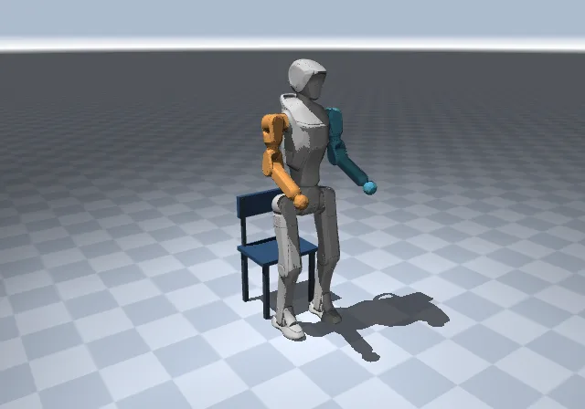
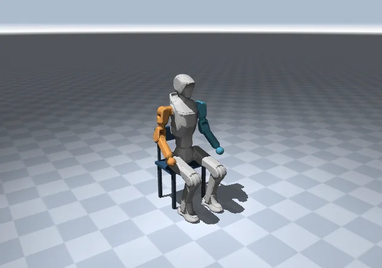
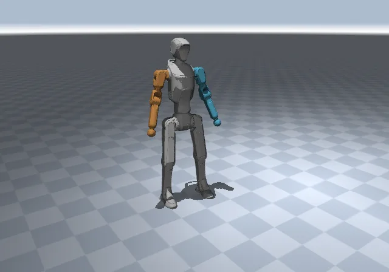
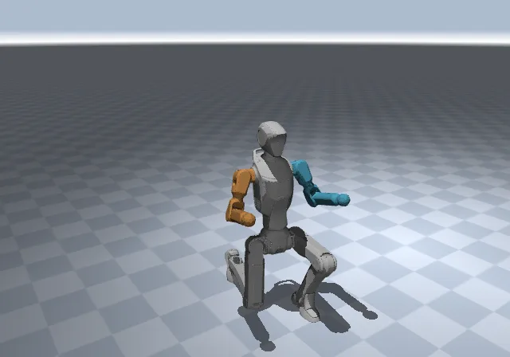

# motion_master（RL 精简版）

CR1 人形机器人运动控制程序，包含 RL、Run、站立、坐下/起立、蹲下/站立，以及准备与安全停机状态。旧 Run1、Run2、Run3、Run4 已停用。

## 状态与模型

| 状态 | 内部码 | 用途 |
| --- | --- | --- |
| Idle | `0x0` | 开机默认，零力矩 |
| JointDamping | `0x2` | 软急停/阻尼保护 |
| Restand | `0x1100B` | motion 1：RL Stand 原地站立 |
| Run | `0x1100C` | motion 2：原 NirenWalk，`amp/1028_run/policy_run_2.onnx` |
| MjRun | `0x11018` | 独立 MJLab Walk2Run 状态，`amp/mjlab/model_19999.onnx` |
| Stand2SitMimic | `0x1100D` | motion 3：CR1STANDARD 站立到坐下 |
| Sit2StandMimic | `0x1100E` | motion 4：CR1STANDARD 坐下到站立 |
| DunXia | `0x1100F` | motion 5：完整蹲下后闭环保持末帧 |
| ZhanLi | `0x11010` | motion 6：只从完成的 DunXia 进入 |
| Run1 | `0x11014` | motion 10：旧 Run，已停用 |
| Run2 | `0x11015` | motion 11：已停用 |
| Run3 | `0x11016` | motion 12：已停用 |
| Run4 | `0x11017` | motion 13：已停用 |
| RLControlMode | `0x11` | `amp/std_amp_2.onnx` |
| ZeroPos | `0x20001` | 回零位、进入 RL 的准备状态 |
| ZeroCalibration | `0x20004` | 零位校准 |
| SuspendedStand | `0x20006` | 悬架起立、进入 RL 的准备状态 |
| SquatPreparation | `0x20010` | CR1 Standard 待机进入蹲姿准备，稳定后确认起立 |

正常流程：`Idle → SuspendedStand（或 ZeroPos）→ RLControlMode`。RL 可以请求回到 `ZeroPos` 或 `Idle`；急停/安全故障进入 `JointDamping`，阻尼状态约 10 秒后返回 `Idle`。除表中状态外，旧独立策略状态码不再受理。

手柄的「蹲姿起立」从待机发送 `0x20010`，控制器从实测关节位置用 3 秒插值到 21 轴蹲姿。插值结束且每个关节的位置误差和速度在容差内保持 150 ms 后，才接受「开始站立」的 `0x1100E`。起立使用 `mimic/sit2stand_policy`，播完全部参考帧后可发送「开始运动」`0x11`。行走中仍可用 motion 3 的 `mimic/stand2sit_policy` 进入坐姿，再用 motion 4 起立。

蹲姿按 CR1PRO SDK 关节名称映射到 CR1 Standard，保留腰 yaw、双臂四关节和双腿六关节。DDS `/CR1_HANDSET_STATUS` 使用 `0x40000000` 标识准备到位或起立完成。当前 Android 通过 RobotServer 的运动状态反馈切换按钮，机器人端按实测姿态强制检查到位。

RLControlMode 从 `/opt/robot/share/motion_master/policy/amp/std_amp_2.onnx` 加载模型，沿用原 `ChiqiangWalkPolicyRunner` 的 78×6＝468 维观测、关节顺序、PD 和步态相位实现。速度范围为 X [-0.6, 1.2] m/s、Y ±0.5 m/s、Yaw ±1 rad/s。

`run_policy/cr1/policy/` 及其安装目录按策略类型组织：

- `amp/` 存放 `nirenwalk_18000.onnx`、1117/1118 行走、1028 Run 和 `std_amp_2.onnx`。RLControlMode 使用 `ChiqiangWalkPolicyRunner` 加载 `amp/std_amp_2.onnx`；Run 仍加载 `amp/1028_run/policy_run_2.onnx`。
- `rl/` 存放 Restand 使用的 `RL_stand.onnx`。
- `mimic/` 存放坐下、起立、蹲下和站起的模型与动作清单。这些策略使用参考动作数据，当前导出已把参考帧嵌入 ONNX。

旧 Run1–Run4 模型归档在工作区根目录的 `policy/disabled_run_policies/`。

Run（motion 2 / 键盘 V / Retroid B / Skydroid E / DDS `0x1100C`）是原 NirenWalk 的改名状态，继续使用 `/opt/robot/share/motion_master/policy/amp/1028_run/policy_run_2.onnx` 和 `Run1027` 参数，速度范围 X [-1, 2] m/s、Y ±0.6 m/s、Yaw ±1 rad/s。

### MJLab 跑步（mjrun）

CR1 Standard 可从普通「RL模式」、RL站立或「跑步」切入 `mjrun`。先停稳并让摇杆归中，再点击「mjrun」，或通过 DDS 请求 `0x11018`。SDK 在下发首帧关节指令后回报 `0x11018`，并用源状态最后一帧指令做 1 秒全身过渡。过渡完成后先让摇杆回中，确认机器人稳定后再给速度。

策略按 50 Hz 运行。观测为 5 帧 × 72 维、旧帧在前，按机身角速度、投影重力、速度指令、相对关节位置、关节速度 × 0.05 和上一帧原始动作拼接。目标角为训练 YAML 默认姿态 + 0.25 × 输出，PD 参数取自训练执行器配置。指令范围为前向 `[-0.25, 3.0] m/s`、横移 `±0.6 m/s`、转向 `±1.0 rad/s`，前向指令以 `0.8 m/s²` 平滑变化。

`mjrun` 激活后可接受与 Run 相同的目标状态切换：`RLControlMode`、`Restand`、`Run`、`DunXia`、`Stand2SitMimic`、`ZeroPos` 和 `JointDamping`。切回 `RLControlMode` 时先松开摇杆、确认停稳；SDK 会继续以 mjrun 运行至速度指令归零，并保持约 0.26 秒后切回 RL。STOP、安全故障或推理异常优先进入阻尼。需要配套的 SDK 和手柄 APK，不支持从跪姿、椅子动作或待机直接进入。

离线检查：`ctest --test-dir build/tests_mjrun -R '^cr1_mjrun$' --output-on-failure`（在 `BUILD_TESTS_ONLY=ON` 的构建目录编译 `test_mjrun` 后运行）。

旧 Run1（motion 10 / `0x11014`）、Run2（motion 11 / `0x11015`）、Run3（motion 12 / `0x11016`）和 Run4（motion 13 / `0x11017`）不注册控制器、不加载模型；DDS 请求会被拒绝，统一状态转换保护会保持当前状态。

CR1 Standard 的悬挂起立（SuspendedStand）和回零（ZeroPos）均以双肘 −0.2 rad 为目标。进入 RL Stand（Restand，DDS `0x1100B`）时，RL/ZhanLi 来源以双肘 +1.2 rad 为目标，Run/Sit2Stand 来源以 −0.4 rad 为目标；肩部采用站立策略默认角。双臂从上一状态最后下发的指令平滑过渡，过渡时间为 1 秒。可通过 `python -B tests/test_restand.py` 离线验证。

## 控制接口

默认使用 DDS 指令接口；可通过 `MOTION_MASTER_CTRL_MODE=keyboard`、`skydroid` 或 `retroid` 选择其他接口。DDS 订阅 `/MOTION_STATE`、`/GAIT`、`/STEER`、`/REAL_STEER` 等话题。RL 行走步态为 `0x21000`，急停请求为 `0x2`。

键盘模式支持 `Z`（回零位）、`X`（悬架起立）、`C`（RL）、`V`（Run）、`R`（阻尼），以及行走中的 `W/S/A/D/Q/E` 速度控制。

CR1STANDARD 坐下/起立流程：从 RL 或 Run 按 `T` 进入坐下；按 `Y` 请求起立；起立后按 `C` 回 RL 或 `V` 回 Run。DDS 使用 `0x1100D`、`0x1100E`、`0x11`、`0x1100C`。坐下/起立各播放一次，末帧继续接受反馈并运行策略；起立完成前 200 帧后即可响应 RL、Run、Restand 或坐下请求。`Z`、`R` 和安全故障优先退出。

两个动作各有独立的 BeyondMimic runner，均保留 21 维原始动作历史，按训练顺序映射关节和增益，以 50 Hz 推理，每次进入从第零帧重置。坐下使用 `model_stand2sit_1020_21dof.onnx`，观测为 111 维，其中 `projected_gravity = Rᵀ × [0, 0, -1]` 是实际 base_link 坐标系中的 3 维单位重力矢量，对纯偏航旋转不敏感；起立使用 114 维观测，包含进入时航向对齐的 6 维参考相对姿态。支持 CR1STANDARD（21 DOF）；CR1PRO 不注册这两个控制器。模型路径依次为环境变量 `STAND2SIT_MIMIC_POLICY_DIR` / `SIT2STAND_MIMIC_POLICY_DIR`、编译时的本项目模型目录、安装目录 `/opt/robot/share/motion_master/policy/mimic/{stand2sit,sit2stand}_policy`。显式路径或已选模型目录缺少文件时加载失败，避免静默换模型。

进入坐下、起立、蹲下和蹲起站立这四类 mimic 状态时，统一只对 8 个手臂关节做 1 秒 smoothstep 入场混合；腰、腿直接跟随对应 mimic 策略第零帧输出。过渡同时覆盖手臂的 kp、目标位置、kd、目标速度和前馈力矩五列，起点为上一状态最后下发的实际手臂指令。

手柄控制：Retroid 在 RL/Run 中按 `X` 坐下，按 `Y` 请求起立，起立后按 `A` 回 RL 或 `B` 回 Run；Skydroid 对应 `C` 坐下、`D` 起立、`right` 回 RL、`E` 回 Run。坐下/起立反馈码为 `0x1100D` / `0x1100E`；旧 DDS 输入 `0x18` / `0x19` 仍兼容。

离线检查命令：`python3 -B tests/test_sit_stand.py`，需要系统 g++ 和项目内的 x86 ONNX Runtime。测试独立读取 ONNX 常量，与实际推理的观测、动作、关节顺序及每帧参考对比，并验证状态周期、末帧保持、重入、错误反馈和安全退出。测试使用模拟接口，不执行机器人动作；物理动作及目标 ARM 上的 20 ms 推理时限仍需实机验证。

DDS 地址依次为 `0x1100B`（Restand）、`0x1100C`（Run）、`0x1100D`（Stand2SitMimic）、`0x1100E`（Sit2StandMimic）、`0x1100F`（DunXia）、`0x11010`（ZhanLi）。RLControlMode 保持 `0x11`。手柄编号为 motion_1 Restand、motion_2 Run、motion_3 坐下、motion_4 起立、motion_5 蹲下、motion_6 站起、motion_7 手臂抬起、motion_8 手臂放下。motion_9–20 不显示、不注册动作。

蹲下和站立各自使用独立状态和 BeyondMimic runner。键盘 `G` 从 RL/Run/Stand 蹲下；`H` 在蹲下完成后站立。ZhanLi 完成后可请求 RL、Restand、Run、坐下或再次蹲下。Retroid 的 `Y` / Skydroid 的 `D` 在 DunXia 中请求 ZhanLi。详情见 [SQUAT_1026.md](docs/SQUAT_1026.md)。

### MuJoCo 动作画面

使用 CR1 Standard 21 轴模型回放当前四个 ONNX 的内嵌参考轨迹。动画可点开查看；座椅仅示意，画面不是闭环控制或实机稳定性验证。现场操作见[展示流程](../展示流程.md)。

| `Stand2SitMimic`（坐姿） | `Sit2StandMimic`（坐姿起立） |
| --- | --- |
| [](docs/assets/mujoco/stand2sit.webp) | [](docs/assets/mujoco/sit2stand.webp) |

| `DunXia`（蹲下） | `ZhanLi`（蹲起站立） |
| --- | --- |
| [](docs/assets/mujoco/dunxia.webp) | [](docs/assets/mujoco/zhanli.webp) |

### RL 站立内手臂调整

先进入 Restand（motion 1 / `0x1100B`），再通过 `/MOTION_STATE` 发送 motion 7（`0x11011`，双侧 elbow_pitch → −0.4 rad）或 motion 8（`0x11012`，双侧 elbow_pitch → +1.2 rad）。指令仅在 RL Stand 内生效，状态反馈始终为 `0x1100B`；其他状态忽略且不缓存这些命令。每次从上一次下发的双肘位置以 1 秒 smoothstep 过渡，完成后保持目标。

## 构建与部署

```bash
cmake -S . -B build/arm -DBUILD_PLATFORM=arm -DBUILD_SIM=OFF -DSEND_REMOTE=OFF -DROBOT=cr1
cmake --build build/arm -j2
cmake --build build/arm --target normal_package
```

`normal_package` 在构建目录生成 deb。`run_policy/cr1/policy/` 中的模型随包安装。更多配置和 DDS 流程见 `docs/USAGE.md`。

策略头文件位于 `run_policy/cr1/include/`，实现位于 `src/`，新增源文件在 `run_policy/cr1/sources.cmake` 登记。各 runner 实现自己的模型加载、观测、推理和动作转换。状态机通过 `PolicyRunnerBase` 接口调用具体策略。

`state_machine/humanoid/` 存放基础状态和公共状态机。CR1 Standard 专用的 Run、Restand、坐下/起立和蹲起状态位于同级的 `state_machine/humanoid_std/`，由该目录中的 `humanoid_std_state_machine.hpp` 注册。

## x86 离线回归

测试需要 g++、Python 3、NumPy、ONNX、ONNX Runtime 和 PyYAML。可用 `-DCR1_TEST_PYTHON=/path/to/python3` 指定已安装这些依赖的解释器。

```bash
cmake -S . -B build/offline-tests -DBUILD_TESTS_ONLY=ON
cmake --build build/offline-tests -j2
ctest --test-dir build/offline-tests --output-on-failure -j2
```
