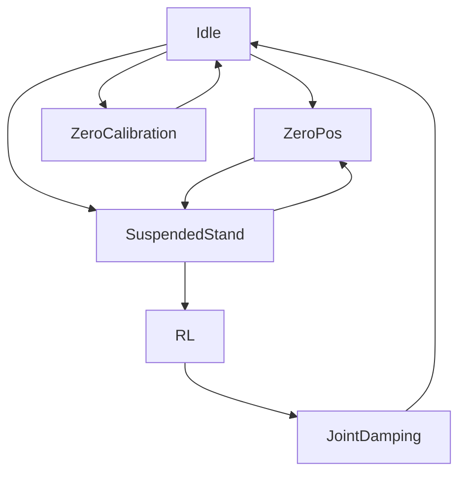

# motion_master 使用说明

> CR1 人形机器人运动控制主程序（motion_master）完整使用指南
> 覆盖：上手准备 → 编译构建 → 部署安装 → 配置 → 运行 → 上位机交互 → 故障排查

---

## 目录

- [1. 项目简介](#1-项目简介)
- [2. 上手准备](#2-上手准备)
- [3. 目录结构](#3-目录结构)
- [4. 编译构建](#4-编译构建)
- [5. 打包 deb](#5-打包-deb)
- [6. 部署安装](#6-部署安装)
- [7. 配置说明](#7-配置说明)
- [8. 运行](#8-运行)
- [9. 状态机与上位机交互](#9-状态机与上位机交互)
- [10. 安全机制与告警](#10-安全机制与告警)
- [11. 日志与监控](#11-日志与监控)
- [12. 常见问题排查](#12-常见问题排查)
- [13. 版本管理](#13-版本管理)

---

## 1. 项目简介

**motion_master** 是 CR1 人形机器人的运动控制主程序，基于 DRDDS 通讯中间件，通过 **RL 策略推理**输出关节指令，并由上位机经 **DDS 指令接口（kDDS）**进行状态/速度控制。

| 项目 | 说明 |
|------|------|
| 适用机型 | CR1PRO（31 DOF）/ CR1STANDARD（21 DOF） |
| 通讯中间件 | DRDDS（FastDDS 定制版） |
| 模型推理 | ONNX Runtime |
| 控制频率 | 电机数据 1kHz 收发，策略 50Hz（decimation=20） |
| 运行平台 | ARM（aarch64，运动主机） |
| 构建系统 | CMake（≥ 3.10）+ GNU Make |

### 1.1 机型差异

| 机型 | DOF 数 | 关节构成 | 备注 |
|------|--------|----------|------|
| CR1PRO | 31 | 腰 3 + 臂 14 + 腿 12 + 脖子 2 | 携带 neck 硬件（可通过配置关闭） |
| CR1STANDARD | 21 | 腰 1 + 臂 8 + 腿 12 | 无脖子关节 |

机型由机器人端配置文件 `/var/opt/robot/conf/robot_hardware_info.toml` 中的 `hardware.model` 字段决定（`CR1_PRO` / `CR1_STANDARD`）。

### 1.2 核心模块

```
state_machine    状态机（Idle / ZeroPos / ZeroCalibration / SuspendedStand / RL / JointDamping）
interface        接口层：硬件（Ecan） + 用户指令（DDS / 手柄）
run_policy       策略库（按机型拆分，运行器源码直接编译进主程序，无需部署动态库）
model_inference  模型推理封装（ONNX Runtime 加载策略网络）
conf             配置文件（config.toml / log.properties / runtime_params.toml）
utils            工具集（SafeController / JointProtection / RuntimeParams / DataStreaming 等）
types            通用类型定义（关节状态、状态机枚举、DDS 消息类型）
third_party      第三方库（drdds / eigen / gamepad / onnxruntime / toml / yaml）
```

---

## 2. 上手准备

### 2.1 开发/部署环境

| 角色 | 平台 | 用途 |
|------|------|------|
| 开发机 | x86_64 Linux | 写代码、交叉编译出 ARM 版本（x86 无 ecanmaster/robotlibs 库，无法原生编译） |
| 运动主机 | aarch64 Linux（机器人板载） | 运行 `motion_master` |

### 2.2 编译工具链（开发机）

```bash
# 基础工具
sudo apt-get install -y build-essential cmake git

# 交叉编译工具（x86 → arm，仅在开发机交叉编译时需要）
sudo apt-get install -y gcc-aarch64-linux-gnu g++-aarch64-linux-gnu

# 自动推送脚本依赖（使用 SEND_REMOTE / sftp_to_remote.sh 时需要）
sudo apt-get install -y expect
```

> 说明：本项目所有第三方库均内置在 `third_party/` 目录下（含 x86 与 arm 两套），**无需单独安装** drdds、eigen、onnxruntime、toml、yaml-cpp 等依赖。

### 2.3 安全操作注意事项（首次使用必读）

> ⚠️ motion_master 是真实机器人运动控制程序，操作前请务必确认以下事项，避免设备损坏或人身伤害。

1. **上电前检查**：确认机器人有悬架支撑（SuspendedStand 需在支撑下进行）或安全吊架就位，机身周围 2m 内无人员/障碍物。
2. **急停按钮**：确认**硬急停按钮**位置并保持可触及；紧急情况下立即按下。释放后程序会等待电机数据就绪（约 5 秒）再自动触发恢复回调。
3. **首次上电**：程序启动后进入 **Idle**（关节 0 力矩），机器人不受力；确认上位机 DDS 指令链路正常后再发送站立/回零指令。
4. **随时可停**：RL 站立与行走过程中，可通过 `/MOTION_STATE` = `0x2`（JointDamping 软急停）或硬急停立即停止运动。
5. **不要徒手支撑**：机器人站立/行走时不要用手直接支撑机身，防止夹伤。
6. **配置修改**：修改 `config.toml`（尤其 `[safe_controller]`、`[joint_protection]`、`[posture_limit]`、`[neck_takeover_control]`）前确认理解其含义；生产环境 `report_only` 必须为 `false`。

---

## 3. 目录结构

```
cr1_deploy/
├── main.cpp                     # 程序入口：初始化 DDS/日志、读取机型、启动状态机
├── CMakeLists.txt               # 顶层构建脚本（编译选项、源文件收集、链接库）
├── config.cmake                 # 打包配置（版本号、CPack、安装规则、deb 生成）
├── README.md                    # 简要说明
├── change_log.md                # 版本变更记录（打包时读取版本号）
├── upload_deb.sh                # 手动把 deb 包 scp 到远程服务器
│
├── conf/                        # 配置文件（源码版本）
│   ├── config.toml              # 主配置：数据流/关节保护/SafeController/脖子接管等
│   ├── log.properties           # log4cplus 日志级别与滚动策略
│   └── runtime_params.toml      # 运行期参数快照（程序自动写，勿手动编辑）
│
├── interface/                   # 接口层
│   ├── robot/                   # 机器人硬件接口
│   │   └── hardware/            # Ecan 硬件（ecan_hardware_interface 基类 + CR1Std/CR1Pro）
│   ├── user_command/            # 用户指令（DDS / Skydroid / Retroid 手柄）
│   ├── data_upload/             # 数据上传接口
│   └── deb_pack/                # deb 安装脚本（postinst / preinst / systemd service）
│
├── state_machine/               # 状态机
│   ├── state_base.h             # 状态基类
│   ├── state_machine_base.h     # 状态机主循环
│   └── humanoid/                # 人形各状态实现（idle/zeropos/rl/damping 等）
│
├── run_policy/                  # 策略库
│   └── cr1/
│       ├── include/             # 策略运行器头文件
│       ├── src/                 # CommonPolicyRunner（ONNX 加载/观测构造/动作输出）
│       └── policy/              # RL 模型 new.onnx，备用模型 old.onnx
│
├── model_inference/             # 模型推理封装
├── types/                       # 通用类型（common_types / custom_types / dds_types）
├── utils/                       # 工具集（safe_controller / joint_protection / runtime_params 等）
├── robot_exe/                   # 数据录制（recorder / snapshot / data_recorder）
├── third_party/                 # 第三方库（dr_lib / eigen / gamepad / onnxruntime / toml / yaml）
└── scripts/
    ├── run.sh                   # 运动主机运行入口
    ├── sftp_to_remote.sh        # 自动推送二进制/模型/配置到机器人
    ├── scp_server_policy.sh     # 从训练服务器拉取策略模型
    ├── scp_torch_to_remote.sh   # 推送 libtorch（历史脚本）
    └── receiver_test.py         # UDP 数据接收测试脚本
```

---

## 4. 编译构建

### 4.1 编译选项一览

| 选项 | 取值 | 默认 | 说明 |
|------|------|------|------|
| `BUILD_PLATFORM` | `arm` / `x86` | 自动检测当前架构 | 目标运行平台（仅支持 ARM） |
| `SEND_REMOTE` | `ON` / `OFF` | `OFF` | 编译完成后是否自动 sftp 推送至机器人 |
| `ROBOT` | `cr1` | `cr1` | 机型选择（当前仅支持 cr1） |

> ⚠️ **重要约束**：
> - 若 `BUILD_PLATFORM` 与当前架构不一致，则自动启用交叉编译（仅支持 x86 → arm）。
> - 已移除仿真支持，目标平台仅支持 ARM（x86 缺 ecanmaster/robotlibs 库，无法原生编译）。
> - `ROBOT` 仅允许 `cr1`，传入其他值会直接报错。

### 4.2 方式一：交叉编译（x86 → arm，最常用）

在 x86 开发机上编译出 ARM 版可执行文件。

```bash
mkdir -p build && cd build
cmake .. -DBUILD_PLATFORM=arm -DSEND_REMOTE=ON -DROBOT=cr1
make -j4
```

- 需要已安装 `gcc-aarch64-linux-gnu` / `g++-aarch64-linux-gnu`（见 §2.2）。
- `SEND_REMOTE=ON` 时，`make` 完成后会自动执行 `scripts/sftp_to_remote.sh` 把产物推送到机器人（需先配置脚本内的 IP/账号/密码，详见 §6.2）。

### 4.3 方式二：运动主机本地编译（arm 板载）

在机器人板载主机上直接编译（不交叉、不推送）。

```bash
mkdir -p build && cd build
cmake .. -DBUILD_PLATFORM=arm -DSEND_REMOTE=OFF -DROBOT=cr1
make -j4
./motion_master
```

### 4.4 常用编译技巧

```bash
# 查看当前构建参数确认
cmake -LA . | grep -E 'BUILD_PLATFORM|SEND_REMOTE|ROBOT'

# 清理后重新构建（强烈建议更换平台后清理）
rm -rf build && mkdir build && cd build

# 多核并行编译
make -j$(nproc)

# 只编译不推送
make -j4 motion_master
```

### 4.5 编译常见问题

| 现象 | 原因与解决 |
|------|-----------|
| 链接报错找不到 `libecanmaster.so` / `libdem.so` | x86 平台缺少 arm 库，无法原生编译；请使用 `BUILD_PLATFORM=arm` 交叉编译或在 ARM 主机上编译 |
| 交叉编译时用了本机 g++ | 确认 `BUILD_PLATFORM=arm` 且系统架构为 x86，CMake 会自动切换 `aarch64-linux-gnu-g++` |
| 链接阶段内存不足/OOM 卡死 | 链接器已加入 `--no-keep-memory --reduce-memory-overheads` 优化；可降低 `-j` 并行度再试 |
| `ROBOT=xxx` 报 `无效的 ROBOT` | 当前仅支持 `cr1` |
| 找不到头文件 `common_types.h` 等 | 确认在 `cr1_deploy` 根目录下执行 cmake（各 include 路径基于工作区根目录） |

---

## 5. 打包 deb

### 5.1 打包命令

```bash
cd build
make -j4          # 先编译出 motion_master 二进制
make package      # CPack 标准打包入口，生成 deb
```

- 使用 CPack 标准 `package` target 即可，**无需** `make normal_package`：`install()` 规则直接引用源目录资源（`conf/`、`scripts/`、`data/`、`interface/deb_pack/` 等），打包前无需额外拷贝资源。
- 打包产物位于 `build/` 目录，例如 `build/motion_master.v1.3.4+dc0976.arm64.2608071601.deb`。

### 5.2 deb 包命名规则

```
motion_master.v<版本号>+<git短哈希>[.dev].<架构>.<yyMMddHHmm>.deb
示例：motion_master.v1.3.4+dc0976.arm64.2608071601.deb
```

- 版本号：从根目录 `change_log.md` 中的 `# v.x.y.z` 解析。
- `.dev` 后缀：当前 Git 分支名含 `/dev/`（如 `dev/xxx`）时追加。
- 架构：`arm64` / `amd64`（根据构建平台自动判定）。
- 时间戳：打包时刻 `yyMMddHHmm`。

打包产物位于 `build/` 目录，例如 `build/motion_master.v1.3.4+dc0976.arm64.2608071601.deb`。

### 5.3 deb 包内容清单（以 arm64 为例）

安装后实际落位如下：

```
/opt/robot/
├── lib/
│   ├── libonnxruntime.so*                # ONNX Runtime 运行库
│   ├── libonnxruntime_providers_shared.so
│   ├── libtls_certificate_info.so
│   ├── libyaml-cpp.so                    # YAML 解析库
│   └── cmake/onnxruntime/ ...            # onnxruntime CMake 配置文件
└── share/motion_master/
    ├── bin/motion_master                 # 主程序可执行文件
    ├── change_log.md
    ├── data/                             # 数据目录
    ├── lib/onnxruntime/                  # onnxruntime 历史版本（可选）
    ├── scripts/
    │   ├── run.sh                        # 运行入口脚本
    │   └── motion_master.service         # systemd 服务单元
    └── policy/
        ├── amp/                         # 行走和 Run 模型
        ├── rl/                          # Restand 模型
        └── mimic/                       # 坐下、起立和蹲起的模型与清单

/var/opt/robot/conf/motion_master/
├── config.toml            # 主配置
├── imu.yaml               # IMU 配置
├── log.properties         # 日志配置
└── runtime_params.toml    # 运行期参数快照
```

> deb 包含 `amp/`、`rl/` 和 `mimic/`，目录结构与源码一致。

---

## 6. 部署安装

### 6.1 方式一：安装 deb 包（推荐）

将 deb 包拷贝到机器人后：

```bash
sudo dpkg -i motion_master.v1.3.4+dc0976.arm64.2608071601.deb
```

`postinst` 脚本会自动完成：
- 给 `/opt/robot/share/motion_master/` 设置 `777` 权限；
- 给 `run.sh` 加可执行权限；
- 安装 `motion_master.service` 到 systemd；
- 设置内核 `core_pattern`（coredump 输出到 `/var/opt/robot/log/system/`）；
- 给 `motion_master` 设置 `cap_sys_nice,cap_net_raw,cap_net_admin+ep` 能力；
- `systemctl daemon-reload` 并 `systemctl restart motion_master.service`。

> `preinst` 会在安装前先 `systemctl stop motion_master.service` 停掉旧进程。

**卸载**：

```bash
sudo dpkg -r motion_master       # 卸载
sudo dpkg -P motion_master       # 卸载并清除配置
```

### 6.2 方式二：手动推送（sftp 脚本）

`scripts/sftp_to_remote.sh`（基于 expect）实现“编译 → 推送 → setcap → 落配置”一键流程，适合开发迭代。

使用前**必须修改脚本内连接参数**：

```tcl
set ip "10.21.41.1"              # 机器人 IP
set username "user"              # 机器人用户名
set passwd "'"                   # 机器人密码
set port 44529                   # SSH 端口
```

脚本执行流程：
1. `./scripts/drsec_tool open_ssh <ip>` 开启 SSH（DR 安全工具，按需配置）；
2. 推送 `run_policy/cr1/policy/` 下的 `amp/`、`rl/` 和 `mimic/` 到 `/opt/robot/share/motion_master/policy/`；
3. 推送编译产物到 `/opt/robot/share/motion_master/bin/`；
4. 推送 `scripts/run.sh`；
5. 执行 `setcap` 赋权；
6. 推送 `conf/config.toml` 并 sudo 落位到 `/var/opt/robot/conf/motion_master/config.toml`。

```bash
# 方式 A：编译时自动推送（SEND_REMOTE=ON）
cmake -S . -B build/arm -DBUILD_PLATFORM=arm -DSEND_REMOTE=ON -DROBOT=cr1
cmake --build build/arm -j4

# 方式 B：单独执行推送脚本
./scripts/sftp_to_remote.sh build/arm/motion_master
```

### 6.3 部署策略模型

deb 和推送脚本都会安装模型。手动复制时，将 `run_policy/cr1/policy/` 下的三个目录完整复制到 `/opt/robot/share/motion_master/policy/`，Mimic 的 `motion.json` 与 ONNX 放在同一子目录。

| 状态 | 相对于机器人 `policy/` 的路径 |
|------|--------------------------------|
| RLControlMode | `amp/std_amp_2.onnx` |
| Run | `amp/1028_run/policy_run_2.onnx` |
| Restand | `rl/RL_stand.onnx` |
| 坐下、起立、蹲下、站起 | `mimic/` 下各动作目录 |

如需更新策略，可修改 `scripts/scp_server_policy.sh` 中的训练服务器路径后执行：

```bash
./scripts/scp_server_policy.sh <模型文件名>   # 从训练服务器拉取到 ../policy/
```

### 6.4 机器人端运行环境核对清单

| 检查项 | 路径 | 说明 |
|--------|------|------|
| 主程序 | `/opt/robot/share/motion_master/bin/motion_master` | 可执行、有 setcap |
| 运行脚本 | `/opt/robot/share/motion_master/scripts/run.sh` | 可执行 |
| systemd 单元 | `/lib/systemd/system/motion_master.service` | 由 postinst 安装 |
| 主配置 | `/var/opt/robot/conf/motion_master/config.toml` | 见 §7 |
| 日志配置 | `/var/opt/robot/conf/log.properties`（程序读取） | 见 §7.3；与 deb 安装路径不一致，见 §7.1 提醒 |
| 硬件型号 | `/var/opt/robot/conf/robot_hardware_info.toml` | `[hardware] model = "CR1_PRO"` 等 |
| 策略模型 | `/opt/robot/share/motion_master/policy/{amp,rl,mimic}/` | deb 自带，路径见 §6.3 |
| 日志目录 | `/var/opt/robot/log/` | 程序日志、coredump |
| 运行期快照 | `/var/opt/robot/conf/motion_master/runtime_params.toml` | 程序自动写 |

---

## 7. 配置说明

### 7.1 配置文件位置与查找优先级

程序运行时会按以下顺序查找配置：

| 配置 | 查找路径 |
|------|----------|
| 主配置 `config.toml` | ① `/var/opt/robot/conf/motion_master/config.toml` ② 当前工作目录 `conf/config.toml` |
| 日志配置 `log.properties` | `/var/opt/robot/conf/log.properties`（main.cpp 硬编码） |
| 硬件型号 | `/var/opt/robot/conf/robot_hardware_info.toml` |
| 运行期快照 | ① `/var/opt/robot/conf/motion_master/runtime_params.toml` ② `conf/runtime_params.toml` |

> ⚠️ **注意**：`log.properties` 程序硬编码读取 `/var/opt/robot/conf/log.properties`（不带 `motion_master` 子目录），而 deb 包安装到 `/var/opt/robot/conf/motion_master/log.properties`。若日志级别/滚动配置不生效，请手动复制一份：
>
> ```bash
> sudo cp /var/opt/robot/conf/motion_master/log.properties /var/opt/robot/conf/log.properties
> ```

### 7.2 config.toml 详解

#### 7.2.1 `[data_stream]` — 数据流

```toml
[data_stream]
enable_online_plot = "false"     # 是否开启在线监测（UDP 推送至上位机）
enable_data_record = "false"     # 是否开启数据录制（CSV 单文件）
enable_file_rotation = "true"    # 是否开启文件轮转（大文件自动切分）
record_freq = "5"                # 录制频率（Hz）
ip = "10.21.41.208"              # 上位机 IP（在线监测/绘图）
port = "9870"                    # 上位机端口
max_file_size_mb = "256"         # 单文件最大大小（MB）
max_file_count = "5"             # 保留的最大轮转文件数
base_directory = "../data"       # 轮转 CSV 目录（robot_data_*.csv）
record_directory = "../data/record"  # 单文件时间戳 CSV 目录
file_prefix = "robot_data"       # 文件前缀
```

#### 7.2.2 `[joint_protection]` — 关节指令三级保护

```toml
[joint_protection]
enabled = true                # 是否启用三级保护
l2_threshold = 10             # L2 滑动窗口内最大允许超限次数，超过则触发阻尼模式
l2_decay_rate = 1             # L2 计数器每帧正常时的衰减量
damping_kd = 10.0             # 阻尼保护模式的 Kd 值（建议 5~10）
margin_l1 = 1                 # L1 位置硬限位在软限位基础上外扩的余量（rad）
l3_log_interval = 1000        # L3 日志记录间隔（每 N 帧）
enable_fault_report = false   # L1/L2 触发时是否通过 FaultClient 上报故障
enable_damping_mode = false   # L2 触发时是否切换到阻尼模式（L1 始终触发阻尼）
```

三级保护机制：
- **L1（硬限位）**：NaN/负值/远超物理极限 → 立即丢弃整帧、切换阻尼、上报 FATAL。
- **L2（软限位）**：超出安全运行范围 → Clamp + 计数，连续超限后切换阻尼，上报 ERROR。
- **L3（理论边界）**：接近正常范围边缘 → 仅记录日志。

#### 7.2.3 `[safe_controller]` — 安全控制器

```toml
[safe_controller]
report_only = false   # true=仅上报不触发软急停（诊断用）；生产环境必须 false
```

- `report_only = false`：故障检测/上报照常，`safe_control_mode` 按实际结果写入，异常会触发软急停（进入 JointDamping）。
- `report_only = true`：强制 `safe_control_mode` 写 0，下游状态机不触发软急停。**仅用于诊断，严禁生产开启。**

#### 7.2.4 `[posture_limit]` — 姿态超限检测

```toml
[posture_limit]
enable = true
roll_threshold_deg = 80.0    # 横滚角阈值（度）
pitch_threshold_deg = 80.0   # 俯仰角阈值（度）
hysteresis_ms = 100          # 迟滞时间（ms），防抖动
```

#### 7.2.5 `[ecan_hardware]` — Ecan 硬件（Pro 版）

```toml
[ecan_hardware]
with_neck = false
# true  : 携带 neck（头部）关节硬件，按真实数据更新与校验
# false : 无 neck 硬件，对 neck 关节下发假数据并跳过数据不更新告警
```

#### 7.2.6 `[neck_takeover_control]` — 脖子接管控制

```toml
[neck_takeover_control]
enable            = false    # 接管全局开关
mechanical_locked = true     # 脖子机械锁死：true 则 neck 整体不控制（优先级最高）
yaw_range_deg     = 45.0     # neckyaw ±量程
pitch_range_deg   = 20.0     # neckpitch ±量程
max_step_deg      = 0.03     # 每 1ms 周期最大步进（等效最大角速度 30°/s）
deadzone          = 0.05     # 指令死区
```

- `enable=true`：任何状态下 neckyaw/neckpitch 由 `/NECK_STEER` 话题指令接管。
- `mechanical_locked=true`：neck 关节指令整行（kp/pos/kd/vel/tau）全部置零。

### 7.3 log.properties — 日志配置

```properties
log4cplus.rootLogger=DEBUG,DR_LOG
log4cplus.appender.DR_LOG.Appender.FilenamePattern=%d{yyyy_MMdd}/${module_name}.%d{yyyy_MMdd}.log
log4cplus.appender.DR_LOG.Appender.Schedule=DAILY    # 按天滚动
log4cplus.appender.DR_LOG.Appender.MaxHistory=15     # 保留 15 天
```

- 日志输出到 `/var/opt/robot/log/<yyyy_MMdd>/<module>.yyyy_MMdd.log`。
- `rootLogger=DEBUG` 可调为 `INFO` / `WARN` / `ERROR` 降低写入量（高频话题日志较多时建议 `INFO` 以上）。

### 7.4 runtime_params.toml — 运行期参数快照

由 `utils/runtime_params.hpp` 以 1Hz 后台周期回写（`fsync` + `rename` 防损坏），反映各模块**实际加载生效**的参数值，便于在线诊断。

- **禁止手动编辑**（编辑会在下一次写入时被覆盖）。
- 可用 `tail -F` 实时查看：

```bash
tail -F /var/opt/robot/conf/motion_master/runtime_params.toml
```

### 7.5 robot_hardware_info.toml — 硬件型号

机器人端文件，`main.cpp` 读取其 `hardware.model` 字段决定加载哪套硬件接口与关节数：

```toml
[hardware]
model = "CR1_PRO"        # 或 "CR1_STANDARD"
```

> 若解析失败程序会抛异常退出；请确保该文件存在且字段合法。

---

## 8. 运行

### 8.1 直接运行（前台，调试用）

```bash
cd /opt/robot/share/motion_master/bin
./motion_master
```

生产环境建议使用 `run.sh`（设置实时调度与 CPU 绑核）：

```bash
/opt/robot/share/motion_master/scripts/run.sh
```

`run.sh` 内容说明：
```bash
cd /opt/robot/share/motion_master/bin
sudo chmod +x ./motion_master
ulimit -c unlimited                                        # 允许生成 coredump
sudo bash -c "echo '/var/opt/robot/log/system/coredump.%e.%p.%t' > /proc/sys/kernel/core_pattern"
chrt 90 taskset -c 4,5,6,7 ./motion_master                 # 实时优先级 90，绑定 4~7 核
```

> `chrt 90` 需要 root 或 `cap_sys_nice` 能力；绑核 4~7 建议避开系统/网卡中断使用的核心。

### 8.2 systemd 服务（推荐生产使用）

```bash
# 查看服务状态
systemctl status motion_master.service

# 手动启停
sudo systemctl start motion_master.service
sudo systemctl stop motion_master.service
sudo systemctl restart motion_master.service

# 开机自启（默认多用户目标；postinst 默认不 enable，可按需开启）
sudo systemctl enable motion_master.service
sudo systemctl disable motion_master.service

# 实时查看运行日志
sudo journalctl -u motion_master.service -f
```

服务单元（`/lib/systemd/system/motion_master.service`）要点：
- `User=user`，`SupplementaryGroups=video audio tty dialout bluetooth`；
- `ExecStart=/opt/robot/share/motion_master/scripts/run.sh`；
- `Restart=on-failure`，`RestartPreventExitStatus=SIGTERM SIGSEGV`。

### 8.3 启动流程（正常时序）

1. `DrDDSManager::Init(0,"eth0")` 初始化 DDS（绑定 `eth0` 网卡）；
2. `DrLogger::initialize(...)` 初始化日志；
3. 读取 `/var/opt/robot/conf/robot_hardware_info.toml` 确定机型；
4. 启动 `RuntimeParams`（1Hz 快照回写）；
5. 创建 `HumanoidStateMachine`（CR1PRO/CR1STANDARD + DDS 指令接口）；
6. 构造 Ecan 硬件接口：初始化电机（`MotorEnable`）、注册回调、`ResetJointError()`（使能全部关节）；
7. 启动数据发布线程（1ms 周期）与各数据通道；
8. 打印 `Controller will be enabled in 3 seconds!!!`，3 秒后进入 **Idle** 状态（关节 0 力矩，开机默认）。

---

## 9. 状态机与上位机交互

### 9.1 状态机流转



| 状态 | 说明 |
|------|------|
| **Idle**（开机默认） | 空闲，关节不发力（0 力矩） |
| **ZeroPos** | 回零位 |
| **ZeroCalibration** | 打限位校准零位 |
| **SuspendedStand** | 悬架预站立 → 起立，可切入 RL |
| **RL** | RL 策略控制（ONNX 模型推理） |
| **JointDamping** | 软急停，关节阻尼（Kd 阻尼保护） |

### 9.2 状态 / 步态 / 动作 ID（DDS 指令值）

| 枚举 | 值 | 含义 |
|------|-----|------|
| `WaitingForStand` | `0x0` | 空闲（0 力矩，开机默认） |
| `JointDamping` | `0x2` | 软急停，阻尼 |
| `RLControlMode` | `0x11` | RL 模式 |
| `ZeroPos` | `0x20001` | 回零位 |
| `ZeroCalibration` | `0x20004` | 打限位校准零位 |
| `SuspendedStand` | `0x20006` | 悬架站立完成 |
| `HumanWALK`（步态） | `0x21000` | 走路 |
| `Action` 范围 | `0x3000 ~ 0x3004` | 动作指令 |

> DDS 接口内置**证书权限过滤**：当前只接受 `WaitingForStand / JointDamping / RLControlMode / Run / Restand / Stand2SitMimic / Sit2StandMimic / DunXia / ZhanLi / ZeroPos / ZeroCalibration / SuspendedStand` 这些状态，以及 `HumanWALK` 步态；动作指令仍受原有权限限制。`/STEER`、`/REAL_STEER` 速度指令在 RL 的 `HumanWALK` 步态、Run 和 Restand 中生效。RLControlMode 默认加载 `/opt/robot/share/motion_master/policy/amp/std_amp_2.onnx`。

### 9.3 DDS 话题清单

**motion_master 订阅（上位机 → 机器人）：**

| 话题 | 类型 | 说明 |
|------|------|------|
| `/MOTION_STATE` | MotionState | 目标状态（`state` 字段，见 §9.2） |
| `/STEER` | Steer | 速度指令（RL 下 x/y/yaw 映射前进/侧移/转向） |
| `/REAL_STEER` | Steer | 速度指令（带限幅归一化） |
| `/GAIT` | Gait | 目标步态（`gait` 字段） |
| `/ACTION` | StdMsgInt32 | 动作指令（`value` 字段） |
| `/NECK_STEER` | Steer | 脖子接管指令（yaw/pitch） |
| `/elevation_map_img` | Image | 地形高度图（策略输入） |

**motion_master 发布（机器人 → 上位机）：**

| 话题 | 类型 | 说明 |
|------|------|------|
| `/JOINTS_DATA` | Joints | 关节高频数据（位置/速度/力矩/温度/状态字） |
| `/JOINTS_DATA_10HZ` | Joints | 关节数据 10Hz 副本 |
| `/IMU_DATA_HEAD` / `/IMU_DATA_BASE` / `/IMU_DATA_BODY` / `/IMU_DATA_LEG` | Imu/ImuData | 各部位 IMU 数据 |
| `/BATTERY_DATA` | BatteryData | 电池数据（电量/电压/电流/保护状态） |
| `/HES_STATUS` | StdMsgInt32 | 硬急停状态 |

### 9.4 上位机控制基本流程

1. 机器人开机，motion_master 进入 **Idle**；
2. 发布 `/MOTION_STATE` = `0x20006`（SuspendedStand）→ 起立；
3. 起立完成后发布 `/MOTION_STATE` = `0x11`（RLControlMode）→ 进入 RL；
4. 在 RL 状态下发布 `/GAIT` = `0x21000`（HumanWALK），再通过 `/STEER`（或 `/REAL_STEER`）下发 x/y/yaw 速度；
5. 需要急停时发布 `/MOTION_STATE` = `0x2`（JointDamping）或触发硬急停。

> 提示：非 RL 状态或未选择 HumanWALK 步态时，速度指令会被清零（`forward/side/turnning_vel_scale = 0`），属正常行为。

### 9.5 控制方式说明

- 当前 `main.cpp` 固定使用 **DDS 指令接口（`RemoteCommandType::kDDS`）**，§9.3 的 DDS 话题是唯一激活的控制通道。
- 代码中仍保留 **Skydroid / Retroid 手柄**接口（`kSkydroid` / `kRetroid`，UDP 端口 `12121`），但**默认未启用**；如需切换，需修改 `main.cpp` 中 `HumanoidStateMachine` 的 `RemoteCommandType` 参数并重新编译。

---

## 10. 安全机制与告警

### 10.1 SafeController（安全控制器）

- 故障检测/分组/分级，软急停，姿态超限检测；
- 主板电压、电机通信状态（错误帧/丢包）、驱动器温度等均接入 DEM 故障上报（内部去重，状态变化才发布）。

### 10.2 JointProtection（关节指令三级保护）

见 §7.2.2。触发 L1/L2 后进入阻尼模式，避免危险指令下发到电机。

### 10.3 关键告警日志含义

| 日志 | 含义 | 处理建议 |
|------|------|----------|
| `Battery UNDERVOLTAGE: bat<54V` | 电池欠压 | 充电/更换电池 |
| `Battery OVERVOLTAGE: bat>90V` | 电池过压 | 检查充电器/电池 |
| `Battery voltage ZERO detected` | 电压采集为 0 | 检查电压采集链路 |
| `CAN BUS-OFF! bus_off changed 0->1` | CAN 总线异常关闭 | 检查 CAN 接线/终端电阻/驱动 |
| `err_frame / pkt_loss >= 50` | 错误帧/丢包超阈值 | 检查总线质量、线缆屏蔽 |
| `关节 N 数据不更新次数超过...` | 关节数据不更新 | 检查该关节接线（见 §10.4） |
| `DDS_CMD topic data update timeout` | DDS 指令超时 | 上位机掉线/未下发指令，超 2.5s 自动 disable |

### 10.4 关节数据不更新检查逻辑

`handleMotorDataCheck` 持续监控每个关节 pos/vel/tor 是否刷新，累计阈值：
- `≥10`：WARN（检查接线）
- `≥100`：WARN（检查关节是否正常）
- `≥1000`：ERROR（检查关节是否在线）

> 若 `with_neck = false`，neck 关节（末尾段）为假数据填充，自动跳过该检查，避免误报。

### 10.5 硬急停恢复

- 硬急停按下 → 进入保护；释放后，程序等待 `kHstopRecoverDataFrames=5000` 帧电机数据（确保数据就绪）再触发 `OnHardStopRecoveredAllJoints()` 回调；
- 恢复期间外部指令一律走阻尼模式（`sendDampingCommand`），避免与恢复线程争抢电机命令。

---

## 11. 日志与监控

### 11.1 程序日志

```bash
# 程序日志（按天滚动，保留 15 天）
ls -la /var/opt/robot/log/
tail -F /var/opt/robot/log/$(date +%Y_%m%d)/ecan.$(date +%Y_%m%d).log

# systemd 服务日志
sudo journalctl -u motion_master.service -f
```

### 11.2 数据录制与在线监测

- `[data_stream] enable_data_record = true`：CSV 录制到 `base_directory`（默认 `../data`，即 `/opt/robot/share/motion_master/data/`）；
- `enable_online_plot = true`：程序本地绑定 UDP `10121`，向 `[data_stream] ip:port`（默认 `10.21.41.208:9870`）推送 JSON 数据，上位机在该地址监听即可实时绘图；
- 轮转 CSV 文件名 `robot_data_*.csv`，按 `max_file_size_mb` 与 `max_file_count` 自动切分与清理。

### 11.3 coredump

- `run.sh` 已开启 `ulimit -c unlimited` 并设置 core_pattern；
- coredump 输出到 `/var/opt/robot/log/system/coredump.<exe>.<pid>.<ts>`。

---

## 12. 常见问题排查

| 问题 | 排查步骤 |
|------|----------|
| 启动即退出，报 `Error parsing TOML config` | 检查 `/var/opt/robot/conf/robot_hardware_info.toml` 是否存在、`hardware.model` 字段是否正确 |
| 启动卡在初始化 / 电机使能失败 | 检查 Ecan 网卡（默认 `eth1`）、CAN 是否正常；查看 `/var/opt/robot/log/` 下 `ecan` 日志 |
| 进入 RL 报 `ONNX model file not found` | 检查 `/opt/robot/share/motion_master/policy/amp/std_amp_2.onnx`，部署路径见 §6.3 |
| 上位机收不到 `/JOINTS_DATA` | 确认 DDS 初始化网卡 `eth0` 正确；用 `drdds` 工具/`receiver_test.py`（UDP 端口 `43897`）验证链路 |
| 日志级别/滚动配置不生效 | `log.properties` 程序读取 `/var/opt/robot/conf/log.properties`，deb 安装在 `.../motion_master/` 子目录；复制一份到上层路径（见 §7.1） |
| 手柄无响应 | 当前 `main.cpp` 固定 DDS 控制，手柄接口未启用（见 §9.5）；需改源码重新编译 |
| 机器人无响应（DDS 超时） | 查看 `DDS_CMD topic data update timeout` 日志，恢复上位机指令流；超 2.5s 会自动 disable |
| 软急停被触发（进入 JointDamping） | 查看 `safe_controller` 日志定位触发原因（电压/温度/姿态/关节更新等），排除后发送 `0x20006` 恢复 |
| 某关节数据不更新 | 按 §10.4 阈值告警定位关节号，检查该关节 CAN 接线与驱动器 |
| 脖子关节不动 | 检查 `[neck_takeover_control] mechanical_locked` 与 `enable` 配置；Pro 版才支持脖子 |
| 日志刷屏 / 性能下降 | 调低 `log.properties` 日志级别（`INFO` 以上）；确认 `enable_data_record`/`enable_online_plot` 按需开启 |

---

## 13. 版本管理

- 版本号来源：`change_log.md` 中的 `# v.x.y.z`（打包时自动解析）。
- 提交规范建议：在 `change_log.md` 顶部新增版本条目，标注：
  - `[+]` 新增功能
  - `[!]` Bug 修复
  - `[*]` 变更/更新/优化/重构
- deb 包文件名包含 Git 短哈希与打包时间，便于追溯。

---

*本文档基于当前仓库代码整理，路径与配置项如有出入请以源码与机器人实际部署为准。*
