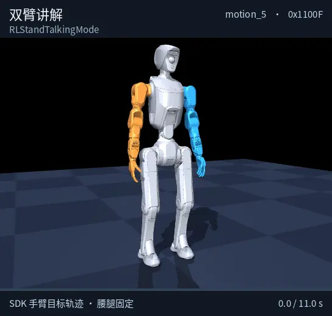
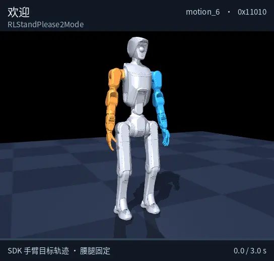
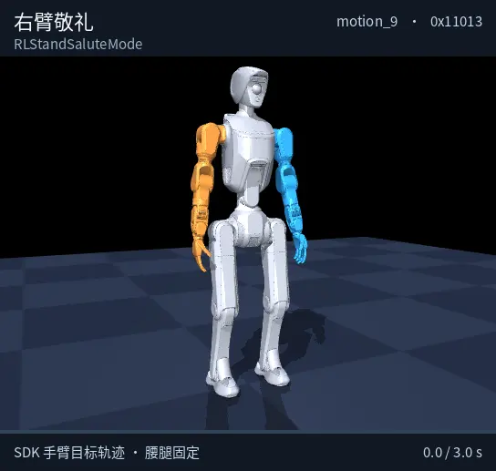
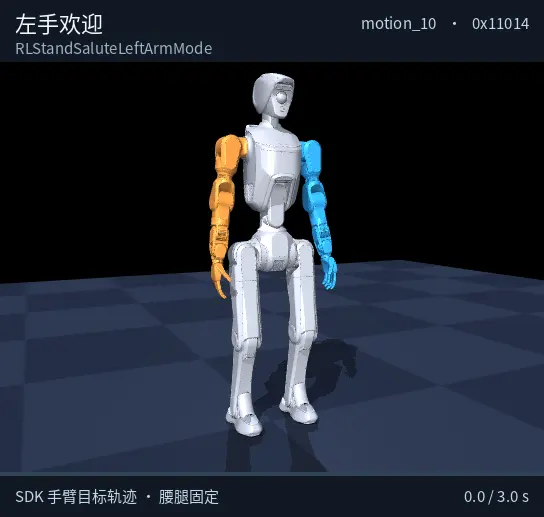
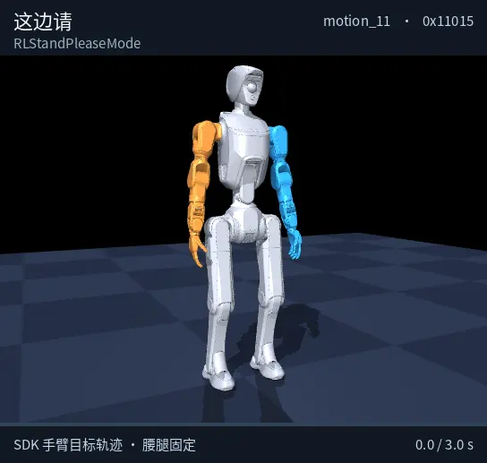
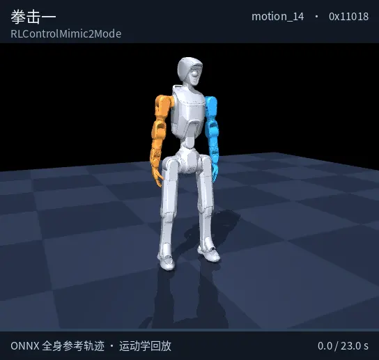
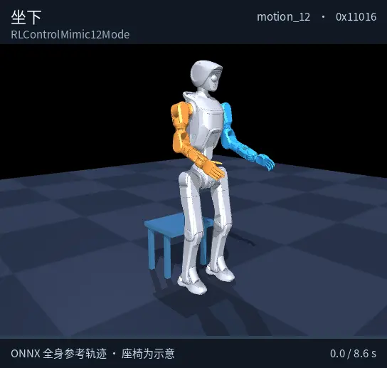
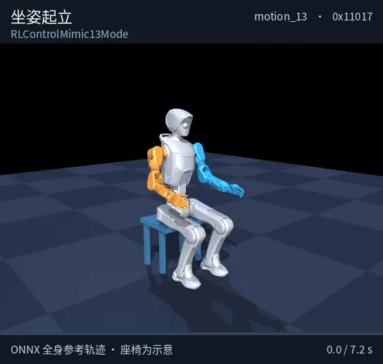

# CR1PRO 展示手柄触摸操作说明

适用于 `pro_sdk_yj` 的 CR1PRO 全身控制和 DDS 手柄。手柄「RL模式」动作页显示下表中的 10 个动作按钮。手柄操作可在 [HTML 口令预览](preview/cr1pro-button-demo.html) 中核对。

[🟢 标准展示顺序](#cr1pro-sequence) · [🔵 按钮速查](#cr1pro-buttons) · [🎬 动作与动画](#cr1pro-motions) · [🛑 异常处理](#cr1pro-troubleshooting) · [⚙️ SDK 状态码](#cr1pro-sdk)

## 开场到结束

> **🟢 开场**　空闲 → 悬吊起立 → 开始运动 → RL模式（普通 AMP 行走）
>
> **🔵 单项展示**　摇杆归中 → 选一个动作 → 回到 RL模式 → 停稳后结束

> **⚠️ 切换动作前**
>
> - 一次只点一个功能按钮。按钮高亮表示已进入对应状态，等动作走完、姿态稳定后再点下一步。
> - 坐下完成后，用「坐姿起立」按钮。站稳后再点「RL模式」。
> - 开始走路或切换步态前，确认行走方向留有空间。拳击按现场已完成真机彩排的项目选用。

## 标准展示顺序

1. **开场检查**。确认手柄已连接并取得控制权限，机器人处于空闲且无故障，摇杆归中，动作范围内没有人员和障碍物。
2. **悬吊起立**。确认机器人处于悬吊状态且双脚离地，按 App 提示点击「悬吊起立」并确认。给准备动作预留 **约 3 秒**，观察机器人姿态稳定。
3. **开始运动**。确认双脚完全接触地面、姿态稳定，再点「开始运动」并确认。等动作页显示「RL模式」高亮。
4. **普通行走与单项展示**。先用小幅摇杆演示普通行走。每项开始前松开摇杆，等机器人停稳。可以依次展示 RL 站立、敬礼、拳击、坐下与起立，每项走完再回「RL模式」。
5. **结束展示**。完成当前项目的回程，回「RL模式」并停稳。按现场收机流程给机器人可靠支撑，再点 App 顶部 `STOP`。SDK 进入关节阻尼，**约 10 秒**后回空闲，卸力期间保持支撑。

## 触摸按钮速查

| 触摸按钮 | 机器人实际做什么 | 从哪里进入 | 完成后怎么操作 |
| --- | --- | --- | --- |
| **悬吊起立** | 进入 AMP 站立准备 | 空闲，已按 App 要求悬吊 | 准备完成且双脚落地后点「开始运动」 |
| **开始运动 / RL模式** | 进入普通 AMP 行走，是各展示项目的返回入口 | 已完成站立准备，或已完成单项回程 | 确认「RL模式」高亮且姿态稳定，再走路或选动作 |
| **motion_1** | RL 原地站立 | 「RL模式」下停稳后 | 点「RL模式」 |
| **motion_2** | 跑步（walk2run） | 「RL模式」下停稳后 | 停稳后返回「RL模式」，也可接 `motion_8` |
| **motion_3** | 原地站立，做双臂讲解手势并持续摆动 | 「RL模式」下停稳后 | 点「RL模式」，等双臂收回且模式已切回 |
| **motion_4** | 原地站立，做第二套「请」的手势 | 「RL模式」下停稳后 | 点「RL模式」，等双臂收回且模式已切回 |
| **motion_5** | 右臂敬礼并保持 | 「RL模式」下停稳后 | 点「RL模式」，等右臂收回且模式已切回 |
| **motion_6** | 左臂做预设手势并保持 | 「RL模式」下停稳后 | 点「RL模式」，等手臂过渡完成且模式已切回 |
| **motion_7** | 原地站立，做「请」的手势 | 「RL模式」下停稳后 | 点「RL模式」，等双臂收回且模式已切回 |
| **motion_8** | 从站姿坐下并保持 | 「RL模式」或 `motion_2` 下停稳后 | 坐稳后点 `motion_9` |
| **motion_9** | 从坐姿起立 | `motion_8` 坐稳后。空闲蹲姿流程的「开始站立」也调用该动作 | 站稳后点「RL模式」 |
| **motion_10** | 低 KP 拳击 | 「RL模式」下停稳后 | 等动作结束且姿态稳定，再点「RL模式」 |
| **STOP** | 发送软急停，SDK 进入关节阻尼 | 异常时，或正常结束且机器人已有支撑时 | 等回到空闲，检查现场后再重新开始 |

## 单项展示步骤

> **🎬 MuJoCo 动画可点击放大**　🔵 左臂　🟠 右臂
>
> 手势按 SDK 的手臂目标轨迹回放，腰腿固定。全身动作按 ONNX 参考轨迹回放，座椅位置用于示意，躺下和起身画面做了贴地对齐。真机操作和等待时间按本节步骤执行。

### 1. 普通行走

1. 按开场顺序完成「悬吊起立」和「开始运动」。
2. 确认「RL模式」高亮，先用小幅摇杆低速前进。机器人稳定后再做转向或侧移。
3. 演示完松开摇杆，保持「RL模式」，等机器人停稳再切换下一项。

### 2. RL 原地站立

从「RL模式」停稳后点「站立」(`motion_1`)。展示完点「RL模式」。

### 3. 跑步

从「RL模式」停稳后点「跑步」(`motion_2`)。演示结束后减速并停稳，再点「RL模式」。

### 4. 敬礼、讲解与邀请手势

1. 从「RL模式」停稳后选一个上肢动作。`motion_5` 是右臂敬礼，`motion_6` 是左臂手势，`motion_3` 是双臂讲解，`motion_4` 和 `motion_7` 是两套邀请手势。
2. 保持摇杆归中，等手臂到位。`motion_3` 的手臂会持续摆动，完成讲解展示后即可请求返回。
3. 点「RL模式」，让机器人完成收臂或手臂交接。看见「RL模式」高亮并确认站稳后，才给摇杆指令或进入下一项。

| `motion_3` 双臂讲解 | `motion_4` 欢迎 |
| --- | --- |
|  |  |

| `motion_5` 右臂敬礼 | `motion_6` 左手欢迎 |
| --- | --- |
|  |  |

**`motion_7` 这边请**

### 5. 拳击动作

1. 先清出机器人周围的动作空间，再从「RL模式」停稳后点 `motion_10`。
2. 等动作结束并保持末尾姿态后，点「RL模式」。

### 6. 坐下和起立

> **▶ 操作路线**　**RL模式** → `motion_8` 坐下 → `motion_9` 起立 → **RL模式**

1. 在「RL模式」停稳后点 `motion_8`。
2. 观察机器人完成坐下并保持坐姿，完全坐稳后点 `motion_9`。
3. 等起立动作走完，机器人站稳后再点「RL模式」。

| `motion_8` 坐下 | `motion_9` 坐姿起立 |
| --- | --- |
|  |  |

### 7. 从空闲直接蹲姿起立

1. 确认机器人处于空闲，点「蹲姿起立」并在弹窗里确认。运控用 **3 秒**从当前姿态插值到预设蹲姿，期间按钮显示「等待蹲姿到位…」。
2. 按钮变为「开始站立」后，先观察机器人确实已经蹲稳，再点「开始站立」并确认。
3. 等机器人完成起立并站稳，点动作页的「RL模式」。确认「RL模式」高亮后再操作摇杆或选择展示动作。

## 点了没反应怎么办

1. **动作仍在进行**。等机器人实物到位。坐稳后使用 `motion_9` 起立。
2. **按钮灰色或未出现**。确认机器人是 CR1PRO，App 已连接，手柄处于手动控制并已取得控制权限。
3. **已点返回，界面仍停在手势状态**。敬礼和上肢手势会先收臂或完成手臂过渡，再切回行走。保持摇杆归中，等状态反馈和实际姿态都稳定。

> **🛑 出现明显失稳、打滑、关节异响、抖动或人员误入，立即停止展示。**
>
> 在线时点顶部 `STOP`。断连或指令未送达时按现场硬急停流程处置。处理完故障并确认回到空闲后再重新开场。

## SDK 状态码速查

手柄 DDS 通过 `/MOTION_STATE` 发送 32 位状态码。躺姿和躺姿起立使用保留编号 `motion_11`、`motion_12`。动作按钮隐藏，SDK 拒绝对应的 DDS 命令。

| 按钮或反馈 | SDK 状态或程序用途 | 状态码 |
| --- | --- | --- |
| 空闲 | `Idle` | `0x0` |
| 顶部 `STOP` | `JointDamping` | `0x2` |
| 悬吊起立 | `AmpZeroPos` | `0x20006` |
| 蹲姿起立 | `SquatPreparation` | `0x20010` |
| 开始运动 / RL模式 | `AmpControl_Walk_Mode` | `0x11` |
| `motion_1` | `RLControl_Stand_Mode` | `0x1100B` |
| `motion_2` | `AmpControl_Walk2Run_Mode` | `0x1100C` |
| `motion_3` | `RLControl_StandTalking_Mode` | `0x1100D` |
| `motion_4` | `RLControl_StandPlease2_Mode` | `0x1100E` |
| `motion_5` | `RLControl_StandSalute_Mode` | `0x1100F` |
| `motion_6` | `RLControl_StandSaluteLeftArm_Mode` | `0x11010` |
| `motion_7` | `RLControl_StandPlease_Mode` | `0x11011` |
| `motion_8` | `MimicControl_ChairDown_Mode` | `0x11012` |
| `motion_9` / 开始站立 | `MimicControl_ChairUp_Mode` | `0x11013` |
| `motion_10` | `MimicControl_BoxFight_Mode` | `0x11014` |
| `motion_11`（SDK 保留，禁用） | `MimicControl_LieDown_Mode` | `0x11015` |
| `motion_12`（SDK 保留，禁用） | `MimicControl_GetUp_Mode` | `0x11016` |

随附 App 的「阻尼模式」按钮发送 `0x2000F`。本 SDK 的关节阻尼入口是顶部 `STOP` 发送的 `0x2`，现场按上面的结束和急停流程操作。

编译、部署和键盘映射见 [SDK 使用说明](pro_sdk_yj/docs/USAGE.md)。
