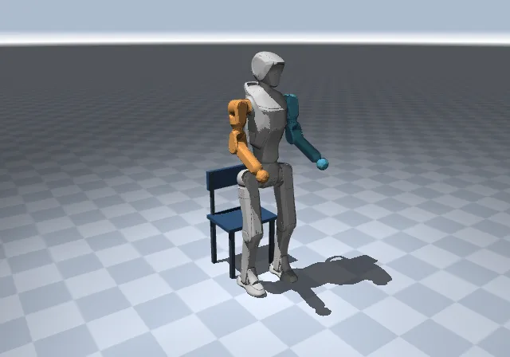
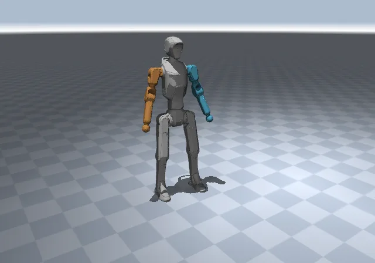

# CR1 Standard 展示流程

适用于 **CR1 Standard（21 自由度）+ 当前 STD 手柄 APK + std_sdk_yj**。本文按当前 SDK 的 `AmpControl_NiRenWalk_Mode`、持枪行走、RL 站立、跑步、椅子、跪姿和 mjrun 状态整理。

[最新手柄 APK](jyandroidSource.djz/jyapp/build/outputs/apk/yunshenchu/release/CR1_V2.2.42_arm64-v8a_11261516.std_yj.apk) · [当前本地 SDK Deb](std_sdk_yj/build/motion_master.v1.3.0+unknown.arm64.2611261457.std_yj.deb)

动作页采用横向排列：

- 宽屏和网页预览为每行 5 个，窄屏及 Android APK 自动换行。
- 第一组动作顺序为「持枪行走 → 跑步(带枪) → 椅子动作 → 跪姿射击 → mjrun(无枪)」。
- 下一组为「RL站立 → 手臂抬起 → 手臂放下」。
- 网页折叠预览中点击「椅子动作」或「跪姿射击」后，选项插入在主动作行下方；同一行其他按钮保持原位，不会因展开而换行。

[🟢 标准展示顺序](#cr1std-sequence) · [🔵 按钮速查](#cr1std-buttons) · [🔀 自动中转](#cr1std-auto-transition) · [🎬 动作与动画](#cr1std-motions) · [🛑 异常处理](#cr1std-troubleshooting) · [⚙️ SDK 状态码](#cr1std-sdk)

## 开场到结束

> **🟢 开场**　待机 → 悬吊起立 → 开始运动／RL
>
> **🔵 单项展示**　摇杆归中 → 停稳 → 选择动作 → 等待到位 → 回程
>
> **结束**　停稳 → 可靠支撑 → `STOP`

> **⚠️ 切换动作前**
>
> - 一次只点一个按钮，等机器人停稳、动作完成后再操作下一项。
> - 按钮高亮表示请求已进入对应状态，不代表动作已经完成。
> - 需要经过 RL 站立完成手臂过渡的路径只需点击最终目标，不要额外点击「RL站立」。
> - 展开椅子或跪姿选项不会改变主行按钮位置；确认目标后先点击子动作。

## 标准展示顺序

1. **开场前**：确认手柄连接、机器人待机、无故障，摇杆归中。清空行走和摆臂区域，座椅、跪垫及保护人员按已彩排位置就位。
2. **悬吊起立**：确认机器人已可靠悬吊、双脚离地，再点「悬吊起立」并确认。当前 SDK 的初始目标姿态为双肘 **+1.2 rad**。
3. **开始运动**：确认双脚落地、姿态稳定，点「开始运动」并确认。机器人进入 `AmpControl_NiRenWalk_Mode 0x11`，加载 `amp/nirenxingzou_fuzai/policy_15500.onnx`。
4. **行走**：从小幅摇杆、低速开始。NiRenWalk、持枪行走和跑步均响应速度控制；每次切换前先松开摇杆并停稳。
5. **持枪与跑步**：
   - 从「开始运动/RL」点「持枪行走」，SDK 自动经过 RL 站立完成手臂平滑，再进入 `0x1100B`。
   - 从「持枪行走」点「跑步(带枪)」，同样自动经过 RL 站立后进入 `0x1100D`。
   - 返回路径也自动处理：持枪行走 → 开始运动/RL、跑步(带枪) → 持枪行走。
6. **RL 站立与手臂**：可点击「RL站立」进入原地站立；站立状态中再点「手臂抬起」或「手臂放下」。两条手臂命令只调整双肘，状态反馈始终为 `0x1100C`。
7. **椅子或跪姿**：停稳后展开对应分组，先执行坐下／跪姿动作，完成后再执行起立。用完后先确认站稳，再选择行走状态。
8. **结束展示**：回到稳定支撑状态，按现场收机流程保护机器人，再使用顶部 `STOP`。SDK 进入 `JointDamping 0x2`，约 10 秒后回到待机；卸力期间必须保持可靠支撑。

## 触摸按钮速查

| 按钮 | SDK 状态或命令 | 说明 | 默认双肘目标 |
| --- | --- | --- | --- |
| **开始运动／RL模式** | `AmpControl_NiRenWalk_Mode 0x11` | 新的拟人行走 RL；加载 `nirenxingzou_fuzai/policy_15500.onnx` | `+1.2 rad` |
| **持枪行走** | `AmpControl_GunShootWalk_Mode 0x1100B` | 普通 RL 持枪行走；加载 `amp/std_amp_2.onnx` | `-0.2 rad` |
| **RL站立** | `RLControl_Stand_Mode 0x1100C` | 原地站立；加载 `rl/RL_stand.onnx` | 默认 `+1.2 rad`；从跑步或椅子起立进入时为 `-0.4 rad` |
| **跑步(带枪)** | `AmpControl_Walk2Run_Mode 0x1100D` | 跑步策略；加载 `1028_run/policy_run_2.onnx` | `+1.2 rad` |
| **椅子动作 → 椅子坐下** | `MimicControl_ChairDown_Mode 0x1100E` | 从站立进入椅子坐姿，参考时长约 8.8 秒 | `+0.8 rad` |
| **椅子动作 → 椅子起立** | `MimicControl_ChairUp_Mode 0x1100F` | 完成坐姿后起立，参考时长约 7.34 秒 | `+0.8 rad` |
| **跪姿射击 → 跪姿射击** | `MimicControl_Kneel_Mode 0x11010` | 进入跪姿射击，参考时长约 5.34 秒 | `+1.2 rad` |
| **跪姿射击 → 跪姿起立** | `MimicControl_Kneel_StandUp_Mode 0x11011` | 仅在跪姿完成后可用，参考时长约 7 秒 | `+1.2 rad` |
| **mjrun(无枪)** | `MjlabControl_Walk2Run_Mode 0x11018` | 独立 MJLab Walk2Run；加载 `amp/mjlab/model_19999.onnx` | `+1.2 rad` |
| **手臂抬起** | `StandElbowMinus04 0x11012` | 仅在 RL 站立内有效，双肘目标 `-0.4 rad` | `-0.4 rad` |
| **手臂放下** | `StandElbowPlus12 0x11013` | 仅在 RL 站立内有效，双肘目标 `+1.2 rad` | `+1.2 rad` |
| **STOP** | `JointDamping 0x2` | 软急停和关节阻尼，约 10 秒后回待机 | 不适用 |

## 自动经过 RL 站立的路径

以下路径中，Android 和 SDK 会保留用户选择的最终目标，自动进入 `RLControl_Stand_Mode 0x1100C`。双肘平滑在 Stand 内完成：目标为持枪行走时到 `-0.4 rad`，目标为开始运动或跑步时到 `+1.2 rad`；完成后自动进入最终状态。操作者只需点击最终目标，无需手动点击「RL站立」。

| 起点 | 最终目标 | 中转 | Stand 内双肘目标 |
| --- | --- | --- | --- |
| 开始运动／RL `0x11` | 持枪行走 `0x1100B` | RL站立 `0x1100C` | `+1.2 → -0.4 rad` |
| 持枪行走 `0x1100B` | 开始运动／RL `0x11` | RL站立 `0x1100C` | `→ +1.2 rad` |
| 持枪行走 `0x1100B` | 跑步(带枪) `0x1100D` | RL站立 `0x1100C` | `→ +1.2 rad` |
| 跑步(带枪) `0x1100D` | 持枪行走 `0x1100B` | RL站立 `0x1100C` | `→ -0.4 rad` |
| 椅子起立 `0x1100F` | 跑步(带枪) `0x1100D` | RL站立 `0x1100C` | `→ +1.2 rad` |
| 椅子起立 `0x1100F` | 开始运动／RL `0x11` | RL站立 `0x1100C` | `→ +1.2 rad` |
| 椅子起立 `0x1100F` | 持枪行走 `0x1100B` | RL站立 `0x1100C` | `→ -0.4 rad` |
| 跪姿起立 `0x11011` | 开始运动／RL `0x11` | RL站立 `0x1100C` | `→ +1.2 rad` |
| 跪姿起立 `0x11011` | 持枪行走 `0x1100B` | RL站立 `0x1100C` | `→ -0.4 rad` |

除以上 5 条路径外，当前 SDK 没有其他强制经过 RL 站立的普通动作切换。例如「开始运动 ↔ 跑步」「椅子起立 → 开始运动」「椅子起立 → 持枪行走」都是直接切换。

## 单项展示与回程

> **🎬 MuJoCo 动画可点击放大**　🔵 左臂　🟠 右臂
>
> 画面使用 CR1 Standard 21 轴模型回放 ONNX 内嵌参考轨迹。座椅和跪垫仅用于示意，不代表闭环仿真或实机稳定性验证。

### 普通 RL、持枪行走与跑步

- **普通拟人行走**：`零位／悬吊起立 → 开始运动/RL → 速度控制`；从待机开始时先执行悬吊起立。
- **持枪行走**：`开始运动/RL → 持枪行走`。SDK 自动经过 RL 站立，手臂从 NiRenWalk 默认 `+1.2 rad` 平滑到持枪策略默认 `-0.2 rad`。
- **反向切回**：`持枪行走 → 开始运动/RL`，同样自动经过 RL 站立。
- **持枪与跑步互切**：`持枪行走 ↔ 跑步(带枪)` 自动经过 RL 站立。
- **开始运动与跑步互切**：可直接切换，不经过 RL 站立。

### RL 站立与手臂

> **▶ 操作路线**　行走状态 → **RL站立** → **手臂抬起／手臂放下（可选）** → 行走状态

RL 站立内始终不响应速度指令。手臂命令会平滑调整双肘，完成后仍停留在 RL 站立。离开后可进入开始运动、持枪行走、跑步、椅子坐下、跪姿、mjrun、回零或 STOP。

### 椅子动作

> **▶ 操作路线**　**持枪行走／跑步(带枪)／开始运动** → 展开「椅子动作」→ **椅子坐下** → **椅子起立** → **开始运动／持枪行走／跑步(带枪)**

坐姿参考约 **8.8 秒**，起立参考约 **7.34 秒**。必须在坐下动作完成后才能请求起立。椅子起立切换到跑步时会自动经过 RL 站立；切换到开始运动或持枪行走时为直接切换。

| 坐姿 · `MimicControl_ChairDown_Mode` | 坐姿起立 · `MimicControl_ChairUp_Mode` |
| --- | --- |
|  |  |

### 跪姿射击

> **▶ 操作路线**　**开始运动／持枪行走／跑步(带枪)／RL站立** → 展开「跪姿射击」→ **跪姿射击** → **跪姿起立** → 行走状态

跪姿参考约 **5.34 秒**，跪姿起立参考约 **7 秒**。跪姿起立只在跪姿动作完整结束后接受请求；完成后可进入开始运动、持枪行走、跑步、RL站立或椅子坐下。

| 跪姿射击 · `MimicControl_Kneel_Mode` | 跪姿起立 · `MimicControl_Kneel_StandUp_Mode` |
| --- | --- |
|  |  |

### mjrun（无枪）

> **▶ 操作路线**　松开摇杆 → 停稳 → **mjrun(无枪)** → 等全身过渡完成并让摇杆保持归中 → 给速度

支持从开始运动、持枪行走、RL站立或跑步切入。进入后 SDK 先使用源状态最后一帧指令做 1 秒全身过渡，再接受速度指令。

可切出至：

- 开始运动／RL、持枪行走、跑步、RL站立
- 椅子坐下、跪姿射击
- 回零、STOP

切回开始运动或持枪行走前，应先松开摇杆；SDK 会等待内部速度指令停稳后再切换。

### 从待机走「蹲姿起立」

这是开场准备路径，不是动作区里的「跪姿射击」。

1. 待机状态点「蹲姿起立」并确认，手柄发送 `SquatPreparation 0x20010`。
2. SDK 从实测关节位置用 **3 秒**插值到准备蹲姿。
3. 关节位置和速度在容差内持续 **150 ms** 后，才接受「开始站立」请求。
4. 起立策略使用椅子起立 `0x1100F`，完成后可点「开始运动」进入 `0x11`。

## 点了没反应或出现异常

1. **动作未完成**：椅子必须完成坐下后才能起立；跪姿必须完成后才能跪姿起立。
2. **速度按钮不响应**：RL站立、椅子、跪姿和 mjrun 过渡阶段会主动清零速度指令，先松开摇杆并等待稳定。
3. **点持枪或跑步后短暂显示 RL站立**：这是预期的自动中转，约 1 秒手臂平滑后会自动进入最终目标。
4. **mjrun 切换被延迟**：从 mjrun 返回开始运动或持枪行走时，SDK 会等待速度指令归零和内部减速帧；保持摇杆归中。
5. **按钮缺失**：确认机器人是 CR1 Standard、处于常规模式、有控制权限，并已进入动作页。

> **🛑 失稳、打滑、异响、抖动或人员误入时，立即停演。**
>
> 手柄在线时使用顶部 `STOP`；断连或指令未送达时按现场硬急停流程处理。确认故障排除、场地清空、机器人回到待机后再恢复。

## SDK 状态码（技术排查）

| App 操作或反馈 | SDK 状态 | 模型或备注 |
| --- | --- | --- |
| 待机 | `WaitingForStand 0x0` | 开机默认 |
| 悬吊起立 | `SuspendedStand 0x20006` | 双肘初始目标 `+1.2 rad` |
| 回零 | `ZeroPos 0x20001` | 双肘 `-0.2 rad` |
| 开始运动／RL模式 | `AmpControl_NiRenWalk_Mode 0x11` | `amp/nirenxingzou_fuzai/policy_15500.onnx` |
| motion_1｜持枪行走 | `AmpControl_GunShootWalk_Mode 0x1100B` | `amp/std_amp_2.onnx` |
| motion_2｜RL站立 | `RLControl_Stand_Mode 0x1100C` | `rl/RL_stand.onnx` |
| motion_3｜跑步(带枪) | `AmpControl_Walk2Run_Mode 0x1100D` | `amp/1028_run/policy_run_2.onnx` |
| motion_4｜椅子坐下 | `MimicControl_ChairDown_Mode 0x1100E` | `mimic/stand2sit_policy` |
| motion_5｜椅子起立 | `MimicControl_ChairUp_Mode 0x1100F` | `mimic/sit2stand_policy` |
| motion_6｜跪姿射击 | `MimicControl_Kneel_Mode 0x11010` | `mimic/dunxia_policy/shoot_down.onnx` + NPZ |
| motion_7｜跪姿起立 | `MimicControl_Kneel_StandUp_Mode 0x11011` | `mimic/zhanli_policy/shoot_up.onnx` + NPZ |
| motion_8｜手臂抬起 | `StandElbowMinus04 0x11012` | 双肘目标 `-0.4 rad`，反馈仍为 `0x1100C` |
| motion_9｜手臂放下 | `StandElbowPlus12 0x11013` | 双肘目标 `+1.2 rad`，反馈仍为 `0x1100C` |
| mjrun｜mjrun(无枪) | `MjlabControl_Walk2Run_Mode 0x11018` | `amp/mjlab/model_19999.onnx` |
| 待机蹲姿准备 | `SquatPreparation 0x20010` | 3 秒插值 + 150 ms 稳定检查 |
| 顶部 STOP | `JointDamping 0x2` | 约 10 秒后回待机 |

更多说明：[SDK README](std_sdk_yj/README.md) · [编译、部署与键盘操作](操作流程.md)。
