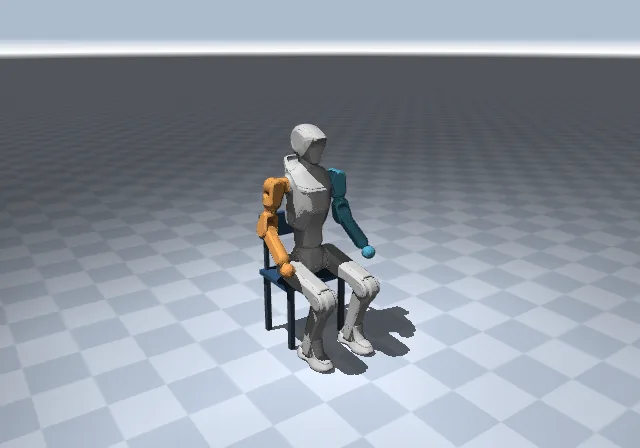
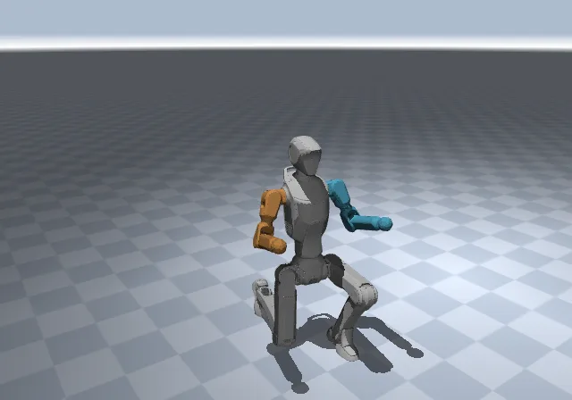

# CR1 Standard 展示流程

适用于 **CR1 Standard（21 轴）+ DDS 手柄**。左侧动作区首行横排「RL站立」「手臂抬起」「手臂放下」，其余按钮向下排列，超出屏幕时可滚动。「椅子动作」和「跪姿射击」默认收起，点击分组标题仅展开或收起选项。 [11 月 24 日 mjrun 版手柄 APK](software/1124/mjrun/CR1_V2.2.42_arm64-v8a_11241530.std_yj.apk)

[🟢 标准展示顺序](#cr1std-sequence) · [🔵 按钮速查](#cr1std-buttons) · [🎬 动作与动画](#cr1std-motions) · [🛑 异常处理](#cr1std-troubleshooting) · [⚙️ SDK 状态码](#cr1std-sdk)

## 开场到结束

> **🟢 开场**　待机 → 悬吊起立 → 开始运动 → RL模式（普通行走）
>
> **🔵 单项展示**　摇杆归中 → 停稳 → 选择一个动作 → 回到 RL模式
>
> **结束**　停稳 → 可靠支撑 → `STOP`

> **⚠️ 切换动作前**
>
> - 一次只点一个按钮。高亮表示进入对应状态，**不代表动作完成**；等动作走完、姿态稳定后再点下一步。
> - 坐姿和蹲姿要走各自的起立回程，**站稳后**再点「RL模式」。

## 标准展示顺序

1. **开场前**：确认手柄已连接、机器人处于待机且无故障，摇杆归中。清空动作区域，给行走、转向和摆臂留出空间。座椅、支撑和动作顺序以现场已彩排的布置为准。
2. **悬吊起立**：按 App 提示确认机器人已可靠悬吊、双脚离地，再点「悬吊起立」并确认。等待站立准备动作完成。
3. **开始运动**：按提示确认双脚完全落地、姿态稳定，再点「开始运动」并确认。看到「RL模式」高亮后方可操作摇杆。
4. **普通行走与单项展示**：从小幅摇杆、低速开始。每项之间先松开摇杆，等机器人停稳，再切换。建议先演示普通行走，再做 RL 站立与手臂动作；跑步、椅子和蹲姿项目按现场条件选用。
5. **结束展示**：完成当前动作的回程，回到「RL模式」并停稳。按现场收机流程给机器人可靠支撑，再使用顶部 `STOP`。SDK 进入关节阻尼，**约 10 秒**后回待机，卸力期间保持支撑。

## 触摸按钮速查

| 按钮 | 实际动作 | 操作时机与回程 |
| --- | --- | --- |
| **RL模式** | 普通 RL 行走，也是动作页的返回按钮 | 完成回程并停稳后点；确认高亮后再给摇杆指令 |
| **RL站立** | 原地抗扰站立，不是行走 | 从 RL 模式停稳后点；站稳后可操作手臂，或返回「RL模式」 |
| **跑步** | 切换到跑步策略 | 确认切换后再给速度；减速停稳后返回「RL模式」 |
| **椅子动作 → 坐姿** | 从站立坐下并保持坐姿 | 确认座椅位置与彩排一致，停稳后点 |
| **椅子动作 → 坐姿起立** | 从坐姿自动站起 | 完全坐稳后点；起立结束并站稳后返回「RL模式」 |
| **跪姿射击 → 跪姿** | 从站姿进入跪姿射击状态 | 停稳且周围无人后点 |
| **跪姿射击 → 跪姿起立** | 从完成的跪姿自动站起 | 完全跪稳后点；站稳后返回「RL模式」 |
| **mjrun** | 切换到独立的 MJLab 步态策略 | 可从普通 RL、RL站立或跑步切入；内部可与 Run 一样切到 RL模式、RL站立、跑步、坐姿、跪姿、回零或 STOP |
| **手臂抬起／手臂放下** | 在 RL 站立中平滑调整双肘，约 1 秒，不切换模式 | 仅「RL站立」中生效；等手臂到位后再点下一项 |
| **STOP** | 发送软急停，SDK 进入关节阻尼 | 异常时立即使用；卸力后机器人可能失去站立支撑 |

## 单项展示与回程

> **🎬 MuJoCo 动画可点击放大**　🔵 左臂　🟠 右臂
>
> 画面使用 CR1 Standard 21 轴模型回放 ONNX 参考轨迹。座椅仅用于示意，不代表闭环仿真、真机动作验证或实物到位。

### RL 站立、手臂与跑步

- **站立与手臂**：`RL模式 → RL站立 → 手臂抬起／手臂放下（可选）→ RL模式`。摇杆保持归中；手臂调整完成且机器人站稳后再返回。
- **跑步**：`RL模式 → 跑步 → 停稳 → RL模式`。只在已留足直线行程和减速距离的区域展示。

### 椅子动作

> **▶ 操作路线**　**RL模式** → 展开「椅子动作」→ **坐姿** → **坐姿起立** → **RL模式**

坐姿参考约 **8.8 秒**，起立参考约 **7.34 秒**。确认完全坐稳后才点「坐姿起立」，起立结束且站稳后再返回。

| 坐姿 · `Stand2SitMimic` | 坐姿起立 · `Sit2StandMimic` |
| --- | --- |
|  |  |

### 跪姿射击

> **▶ 操作路线**　**RL模式** → 展开「跪姿射击」→ **跪姿** → **跪姿起立** → **RL模式**

跪姿参考约 **5.34 秒**，跪姿起立参考约 **7 秒**。完全跪稳后再点「跪姿起立」，站稳后再返回。

| 跪姿 · `DunXia` | 跪姿起立 · `ZhanLi` |
| --- | --- |
|  |  |

### 从待机走「蹲姿起立」

这是另一种开场方式，**不是** RL 动作区里的「跪姿射击」。

1. 确认机器人处于待机，点「蹲姿起立」并确认。按钮显示「等待蹲姿稳定…」。Standard SDK 从实测关节位置用 **3 秒**插值到准备蹲姿。
2. 插值结束且 SDK 检测到关节位置、速度持续 **150 ms** 在容差内，才接受「开始站立」。
3. 点击「开始站立」并确认，等待「正在站立…」结束。起立策略完整播放且机器人站稳以后，点「开始运动」并确认；看到「RL模式」高亮后再开始下一项。

> **⚠️ 按钮亮起不等于已到位。** 当前 App 可能较早显示「开始站立」；仍需等 **3 秒插值完成并确认实际蹲稳**后再点。

## 点了没反应或出现异常

1. **动作还没做完**：先看机器人姿态。坐姿和蹲姿要走各自的起立回程，不能直接跳到「RL模式」。
2. **找不到按钮**：确认已进入「RL模式」，展开对应分组并上下滚动。若仍不显示，检查设备是否为 CR1 Standard、是否在常规模式且有控制权限。手臂调整只在「RL站立」生效。
3. **状态没有切换**：松开摇杆，查看 App 是否持续收到状态反馈，核对连接、故障和切换条件。不要连续点按。

> **🛑 失稳、打滑、异响、抖动或人员误入时，立即停演。**
>
> 手柄在线时使用顶部 `STOP`；断连或指令未送达时按现场硬急停流程处置。确认故障处理、场地清空、机器人回到待机后再恢复。

## SDK 状态码（技术排查）

| App 操作或反馈 | SDK 状态或命令 |
| --- | --- |
| 待机 | `WaitingForStand 0x0` |
| 悬吊起立 | `SuspendedStand 0x20006` |
| 回零 | `ZeroPos 0x20001` |
| 开始运动／RL模式 | `RLControlMode 0x11`，加载 `std_amp_2.onnx` |
| RL站立 | `motion_1` · `Restand 0x1100B` |
| 跑步 | `motion_2` · `Run 0x1100C` |
| 坐姿 | `motion_3` · `Stand2SitMimic 0x1100D` |
| 坐姿起立 | `motion_4` · `Sit2StandMimic 0x1100E` |
| 跪姿 | `motion_5` · `DunXia 0x1100F` |
| 跪姿起立 | `motion_6` · `ZhanLi 0x11010` |
| mjrun | `MjRun 0x11018`，加载 `amp/mjlab/model_19999.onnx` |
| 手臂抬起／手臂放下 | `motion_7 / motion_8` · `0x11011 / 0x11012`，仅 Restand 内生效，状态反馈仍为 `0x1100B` |
| 待机蹲姿起立 → 开始站立 → 开始运动 | `0x20010 → 0x1100E → 0x11` |
| 顶部 STOP | `JointDamping 0x2` |

本 SDK 的 DDS 关节阻尼入口为顶部 `STOP` 对应的 `0x2`。不要把 App 独立的「阻尼模式」按键（通常发送 `0x2000F`）当成此入口。

更多说明：[SDK README](std_sdk_yj/README.md) · [编译、部署与键盘操作](操作流程.md)。
